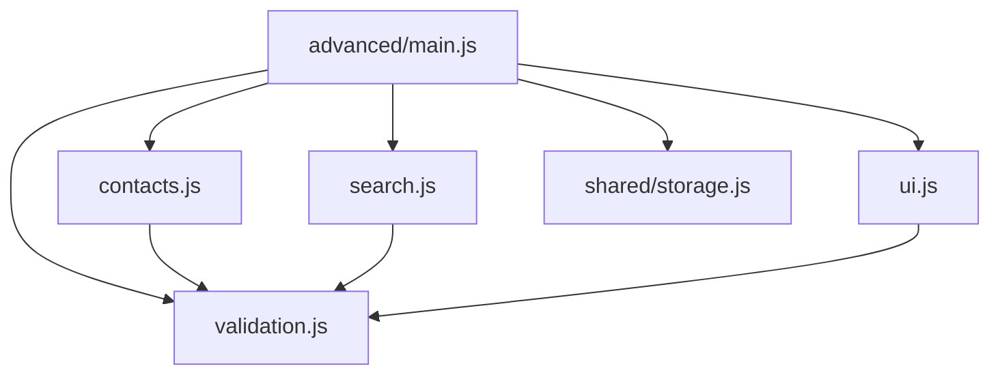

# Лабораторная работа №10 — ES Modules

**Тема:** «Основы модульности и структуры проекта: разделение кода на файлы, использование ES-модулей».

**Студент:** Манкеев Жанибек  
**Группа:** ИС-25-22  
**Дисциплина:** «Языки и технология программирования»  
**Дата:** 04.11.2026

## 1. Как запустить

1. Полностью распакуйте ZIP. Все папки внутри `Lab10_ESModules` должны остаться вместе.
2. Для запуска на компьютере нужен Python 3 и современный браузер.
3. Откройте Терминал в папке `Lab10_ESModules` и выполните:

```bash
python3 start.py
```

На Mac также можно открыть `START_MAC.command`. Если файл не разрешено запускать, используйте команду выше. На Windows откройте `START_WINDOWS.bat`; он запускает `py -3 start.py` либо `python start.py`.

Сервер откроет браузер. Если вкладка не появилась, перейдите на [http://127.0.0.1:8000](http://127.0.0.1:8000). Оставьте окно Терминала открытым; `Ctrl+C` останавливает сервер. На странице `index.html` доступны вкладки **«Базовый»**, **«Средний»** и **«Повышенный»**. Ссылка внизу страницы открывает `report.html`.

Устанавливать пакеты через npm или pip не требуется. Python раздает готовые файлы, а JavaScript выполняется в браузере. Открывайте страницу через HTTP: прямое открытие `index.html` как `file://` мешает загрузке ES-модулей. [MDN: Modules][1]

**Запасной способ запуска** из папки проекта:

```bash
python3 -m http.server 8000 --bind 127.0.0.1
```

Затем вручную откройте [http://127.0.0.1:8000](http://127.0.0.1:8000). Если порт занят, замените в команде `8000` на `8001` и откройте [http://127.0.0.1:8001](http://127.0.0.1:8001). На Windows вместо `python3` используйте `py -3`. Возможности локального сервера описаны в [документации Python][4].

## 2. Цель и выбранные варианты

Цель: организовать JavaScript-приложения с помощью отдельных модулей, применить `import`/`export`, отделить вычисления и данные от DOM, проверить корректный и ошибочный ввод.

В PDF предусмотрен один назначенный вариант. По запросу выполнены три работы: выбран первый вариант каждого уровня, поскольку индивидуальные номера не указаны. Все работы имеют общую страницу запуска и входят в один архив.

| Уровень | Вариант | Задача и реализованные возможности |
|---|---:|---|
| Базовый | 1 | Конвертер температур: °C ↔ °F, °C → K; дополнительно все обратные направления, обмен единиц, сброс и проверка абсолютного нуля. |
| Средний | 8 | Список задач: добавление, выполнение, удаление, фильтры, счетчики и сохранение в браузере. |
| Повышенный | 16 | Мини-CRM: создание, просмотр, изменение и удаление клиентов, проверка данных, поиск, фильтр статуса, сортировка и сохранение. |

## 3. Ход выполнения и обязательные требования

1. Созданы общая HTML-страница, стили и отдельные папки модулей для трех уровней.
2. Формулы, операции с массивами и проверка данных вынесены из DOM-интерфейса.
3. Обработчики событий связывают модели с интерфейсом через именованные экспорты и экспорт по умолчанию.
4. Общий `storage.js` добавляет независимое сохранение JSON и обработку ошибок хранилища.
5. Подготовлены локальный запуск, проверки моделей, таблицы результатов и ответы для защиты.

| Требование задания | Реализация |
|---|---|
| Не менее 3 собственных JS-модулей | Базовый уровень: 3; средний: 3 и общий `storage.js`; повышенный: 5 и общий `storage.js`. |
| Не менее 2 именованных экспортов и 2 импортов | Например, `convertTemperature`, `getFormula`, `addTask`, `toggleTask`; каждый `main.js` уровня импортирует несколько модулей. |
| Не менее 2 событий через `addEventListener()` | Конвертер: `submit`, `input`, `change`, `click`, `reset`; задачи и CRM: `submit`, `input`, `change`, `click`. |
| Разделение ответственности | Модели работают с данными; `ui.js` обновляет DOM; `main.js` связывает действия; `storage.js` сохраняет JSON. |
| Некорректный ввод | Пустые поля, неверные форматы, границы и повторные записи проверяются до изменения данных. |
| Минимум 5 проверок на вариант | Результаты приведены отдельно для каждого уровня в разделе 8. |

## 4. Структура проекта

| Путь | Назначение |
|---|---|
| `index.html` | Общая страница с тремя вкладками и точкой входа `type="module"`. |
| `styles/style.css` | Общие стили, формы, списки и таблица CRM. |
| `src/main.js` | Запуск трех приложений и навигации. |
| `src/navigation.js` | Переключение вкладок, адресный фрагмент и управление клавиатурой. |
| `src/modules/basic/` | `temperature.js`, `ui.js`, `main.js` — базовый уровень. |
| `src/modules/medium/` | `model.js`, `ui.js`, `main.js` — средний уровень. |
| `src/modules/advanced/` | `contacts.js`, `validation.js`, `search.js`, `ui.js`, `main.js` — повышенный уровень. |
| `src/modules/shared/storage.js` | Общий модуль хранения данных в браузере. |
| `start.py`, `START_MAC.command`, `START_WINDOWS.bat` | Запуск локального HTTP-сервера и браузера. |
| `tests/models.test.js` | Автоматические проверки чистых моделей и хранения. |
| `tests/model-results.txt` | Сохраненный результат запуска автоматических проверок. |
| `tests/browser-results.json`, `docs/` | Протокол проверки браузера и реальные скриншоты интерфейса. |
| `package.json` | Режим ES-модулей для Node.js; внешних зависимостей нет. |
| `README.md`, `report.html` | Инструкция и отчет, в том числе материалы для защиты. |

## 5. Модули и экспортируемые функции

В таблице пути `basic/`, `medium/`, `advanced/`, `shared/` относятся к каталогу `src/modules/`.

| Модуль | Основные экспорты и ответственность |
|---|---|
| `basic/temperature.js` | `parseTemperature(value)` проверяет число; `convertTemperature(value, from, to)` переводит единицы; `getFormula(from, to)` возвращает формулу. Экспортирует также `celsiusToFahrenheit`, `fahrenheitToCelsius`, `celsiusToKelvin`, `UNIT_LABELS`, `ABSOLUTE_ZERO`. |
| `basic/ui.js` | `default createTemperatureUI(root)` создает форму; `showTemperatureResult`, `showTemperatureError`, `clearTemperatureResult` обновляют вывод. |
| `basic/main.js` | `initBasic(root)` подключает обработчики формы, сброса и обмена единиц. |
| `medium/model.js` | `addTask(tasks, value)`, `toggleTask(tasks, id)`, `removeTask(tasks, id)`, `clearCompletedTasks(tasks)` возвращают новые массивы; `filterTasks`, `getTaskCounts`, `restoreTasks` выбирают и проверяют данные. Есть `normalizeTitle`, `validateTaskTitle`, `MAX_TITLE_LENGTH`. |
| `medium/ui.js` | `default createTaskInterface(root)` создает интерфейс; `renderTasks`, `showTaskMessage`, `showStorageWarning` отображают состояние. |
| `medium/main.js` | `initMedium(root)` управляет событиями, текущим фильтром и сохранением задач. |
| `advanced/contacts.js` | `addClient(clients, input, id)`, `getClientById(clients, id)`, `updateClient(clients, id, input)`, `deleteClient(clients, id)` реализуют CRUD; `sanitizeClients(value)` проверяет загруженные записи. |
| `advanced/validation.js` | `normalizeClient(input)` нормализует поля; `validateClient(input, clients, excludeId)` возвращает `{ valid, errors, data }`; `CLIENT_STATUSES` задает допустимые статусы. |
| `advanced/search.js` | `searchClients`, `filterClientsByStatus`, `sortClients`; `selectClients(clients, { query, status, sort })` объединяет поиск, фильтр и сортировку. |
| `advanced/ui.js` | `default createCrmUI(root)` создает форму и таблицу, возвращает методы чтения полей и отображения ошибок, списка и режима редактирования. |
| `advanced/main.js` | `initAdvanced(root)` связывает CRUD, проверку, поиск, хранение и интерфейс. |
| `shared/storage.js` | `createStorage(key, adapter)` возвращает методы `load(fallback)`, `save(value)`, `clear()`, `getLastError()`; `adapter` позволяет тестировать хранение без браузера. |
| `src/navigation.js` | `LEVELS` и `initNavigation()` задают допустимые вкладки и их переключение. |

## 6. Ключевые листинги и схема импортов

Подключение в `index.html`:

```html
<script type="module" src="./src/main.js"></script>
```

Именованный экспорт из `src/modules/basic/temperature.js`:

```js
export function celsiusToFahrenheit(celsius) {
  return celsius * 1.8 + 32;
}
```

Импорты из `src/modules/basic/main.js`:

```js
import { convertTemperature, getFormula, parseTemperature } from './temperature.js';
import createTemperatureUI, {
  clearTemperatureResult,
  showTemperatureError,
  showTemperatureResult,
} from './ui.js';
```

`createTemperatureUI` объявлен как `export default function createTemperatureUI(root)`. Он импортируется без фигурных скобок, а именованные экспорты — в скобках. Одновременно использовать оба вида экспорта разрешено. [MDN: export][3]

Пример операции модели из `src/modules/advanced/contacts.js`:

```js
export function deleteClient(clients, id) {
  if (!getClientById(clients, id)) throw new Error("Клиент для удаления не найден.");
  return clients.filter((client) => client.id !== id);
}
```

Функция возвращает новый массив и не обращается к странице. Обработчик в `main.js` сохраняет полученный массив и просит `ui.js` перерисовать таблицу.

| Импортирующий файл | Откуда импортирует |
|---|---|
| `src/main.js` | `modules/basic/main.js`, `modules/medium/main.js`, `modules/advanced/main.js`, `navigation.js` |
| `basic/main.js` | `temperature.js`, `ui.js` |
| `basic/ui.js` | `temperature.js` |
| `medium/main.js` | `model.js`, `ui.js`, `../shared/storage.js` |
| `advanced/main.js` | `contacts.js`, `validation.js`, `search.js`, `ui.js`, `../shared/storage.js` |
| `advanced/contacts.js`, `advanced/search.js`, `advanced/ui.js` | `validation.js` |

Диаграмма файлов повышенного уровня: стрелка обозначает импорт.



Циклов нет: модели и общие модули не импортируют обработчики. Изменение разметки затрагивает `ui.js`, изменение формул — `temperature.js`, правил клиента — `validation.js`. Дополнительный модуль `storage.js` используется двумя приложениями без копирования его кода.

## 7. Данные, ограничения и обработка ошибок

Списки задач и клиентов первоначально пусты. Конвертер ничего не сохраняет. Задачи записываются под ключом `lab10.tasks.v1`, клиенты — `lab10.crm.clients.v1` в `localStorage`. Данные принадлежат этому браузеру и адресу страницы; другой порт или другой браузер использует отдельное хранилище. Очистка данных сайта удаляет записи. [MDN: localStorage][5]

При ошибке чтения JSON приложение начинает с пустого списка; записи неверной структуры пропускаются. Если сохранение недоступно, на странице появляется сообщение, а текущие изменения остаются в памяти вкладки. Это учебная CRM: общей серверной базы, учетных записей и синхронизации между пользователями нет.

| Проверяемые данные | Правило |
|---|---|
| Температура | Конечное число; допустимы точка, запятая и знак минуса. Минимум: −273,15 °C, −459,67 °F или 0 K. Переполнение результата отклоняется. |
| Название задачи | После удаления лишних пробелов — от 1 до 120 символов; одинаковые названия без учета регистра отклоняются. |
| Имя клиента | От 2 до 80 символов после нормализации пробелов. |
| Email клиента | Проверка формата, максимум 254 символа; email уникален без учета регистра. При редактировании собственный email разрешен. |
| Телефон клиента | От 10 до 15 цифр; во вводе разрешены `+`, пробелы, скобки и дефисы. |
| Статус клиента | Только «Новый», «В работе», «Завершён». |

Для демонстрации можно ввести вымышленного клиента: **Алия Садыкова**, `aliya@example.org`, `+7 (701) 123-45-67`, статус «Новый». Пользовательский текст выводится через `textContent`, поэтому введенная HTML-разметка остается текстом.

## 8. Тестирование

Ниже зафиксированы фактически выполненные проверки функций моделей. Они проверяют вычисления и правила работы с данными; результаты браузерной проверки и изображения интерфейса вынесены в следующий раздел. Объединенный набор автоматических тестов завершился успешно: **38 проверок, 38 пройдено, 0 ошибок** — 10 для конвертера, 10 для задач, 12 для CRM и 6 для хранения.

### Базовый уровень — вариант 1

| № | Сценарий и вход | Ожидаемый результат | Фактический результат |
|---|---|---|---|
| Б1 | Корректный ввод: `0 °C → °F` | `32 °F` | `32 °F` — пройдено. |
| Б2 | Пустая строка | Ошибка, без вычисления | «Введите температуру.» — пройдено. |
| Б3 | Неверный формат: `abc` | Ошибка ввода числа | Ошибка ввода числа — пройдено. |
| Б4 | Граница: `−459,67 °F → K` | Точно `0 K` | `0 K` — пройдено. |
| Б5 | Дважды `40 °C → °F` | Оба раза `104 °F` | Одинаковый результат `104 °F` — пройдено. |
| Б6 | `−274 °C → K` | Ошибка абсолютного нуля | Перевод отклонен — пройдено. |
| Б7 | Десятичная запятая: `−12,5 °C → °F` | `9,5 °F` | `9,5 °F` — пройдено. |

### Средний уровень — вариант 8

| № | Сценарий и вход | Ожидаемый результат | Фактический результат |
|---|---|---|---|
| С1 | Добавить `  Сдать   лабораторную  ` | Одна невыполненная задача, лишние пробелы удалены | `id: 1`, «Сдать лабораторную», `completed: false` — пройдено. |
| С2 | Название из двух пробелов | Ошибка пустого названия | «Введите название задачи.» — пройдено. |
| С3 | Вызов модели с числом `123` вместо строки | Ошибка типа данных | «Название задачи должно быть текстом.» — пройдено. |
| С4 | Название из 120 букв | Задача добавлена | Длина названия 120 — пройдено. |
| С5 | Название из 121 буквы | Ошибка длины | Сообщение об ограничении 120 символов — пройдено. |
| С6 | После «Сдать работу» добавить ` сдать   РАБОТУ ` | Дубликат отклонен | «Такая задача уже есть в списке.» — пройдено. |
| С7 | Дважды переключить выполнение одной задачи | Вернуться к `completed: false` | Состояние восстановлено, исходный массив не изменен — пройдено. |

### Повышенный уровень — вариант 16

Для П1 используется запись: `name: '  Алия   Садыкова '`, `email: 'ALIYA@EXAMPLE.ORG '`, `phone: '+7 (701) 123-45-67'`, `status: 'Новый'`, `id: 'client-1'`. Остальные изменения применяются к этим корректным данным.

| № | Сценарий и вход | Ожидаемый результат | Фактический результат |
|---|---|---|---|
| П1 | Добавление корректной записи | Одна нормализованная запись | «Алия Садыкова», `aliya@example.org`, `+77011234567` — пройдено. |
| П2 | Пустое имя | Ошибка, запись не добавляется | `valid: false`, ошибка имени — пройдено. |
| П3 | Email `no-email` | Ошибка формата | `valid: false`, ошибка email — пройдено. |
| П4 | Имя из 2 и 80 букв; телефон из 10 и 15 цифр | Граничные значения разрешены | Обе пары допустимы — пройдено. |
| П5 | Имя из 81 буквы | Ошибка длины | `valid: false` — пройдено. |
| П6 | Повторно добавить тот же email с другим ID | Дубликат отклонен | Ошибка «Клиент с таким email уже существует.» — пройдено. |
| П7 | Изменить статус на «В работе», найти по `САДЫКОВА` | Обновление и одна найденная запись | Статус обновлен, найден 1 клиент — пройдено. |
| П8 | Удалить единственного клиента по ID | Пустой список | `[]` — пройдено. |

**Повторный запуск автоматических проверок**: нужен Node.js 18 или новее только для тестов. Из папки проекта выполните:

```bash
node --test tests/models.test.js
```

Тесты используют встроенные `node:test` и `node:assert/strict`; установка npm-пакетов не нужна. Сохраненный вывод находится в `tests/model-results.txt`.

## 9. Проверка в браузере и скриншоты

**Выявленная и исправленная ошибка.** При переключении вкладок запись в `location.hash` перемещала фокус с кнопки на раздел. Из-за этого последовательное управление клавишами `Home` и `ArrowRight` работало неправильно. В `src/navigation.js` обновление адреса заменено на `history.pushState`, добавлен обработчик `popstate` для переходов назад и вперед.

**Браузер:** Chromium 153.0.8010.0. **Результат: 30 проверок пройдено, 0 ошибок.** Все 14 JS-модулей загружены через HTTP со статусом 200; ошибок загрузки в Network и необработанных ошибок в Console не обнаружено. Подробный протокол: `tests/browser-results.json`.

Проверены ввод данных во всех трех интерфейсах, сохранение после перезагрузки, подтверждение и отмена удаления клиента, управление вкладками с клавиатуры после исправления, работа при поврежденном и недоступном `localStorage`. На ширине 390 px у всех трех разделов отсутствует горизонтальное переполнение страницы.

Запуск `start.py` проверен в Linux. Обертки `START_MAC.command` и `START_WINDOWS.bat` подготовлены для соответствующих систем; отдельные запуски на macOS и Windows не выполнялись.

**Базовый уровень — конвертер температур.**


**Средний уровень — список задач.**


**Повышенный уровень — мини-CRM с вымышленными данными.**


**Интерфейс на узком экране, ширина 390 px.**


## 10. Ответы на контрольные вопросы

Нумерация 9–20 сохранена из задания.

### 9. Что такое модуль в JavaScript?

Это отдельная единица кода со своей областью видимости. `export` открывает нужные функции и данные для других модулей, а `import` подключает их. [MDN: Modules][1]

### 10. Чем ES-модули отличаются от обычных скриптов?

ES-модули поддерживают статические `import`/`export`, выполняются в строгом режиме и имеют собственную область видимости. Их зависимости загружаются по импортам. [MDN: import][2]

### 11. Для чего нужен `type="module"`?

Он сообщает браузеру, что подключенный скрипт нужно интерпретировать как ES-модуль. В проекте этот атрибут стоит у подключения `src/main.js`. [MDN: import][2]

### 12. Как работает именованный `export`?

Он публикует значение под определенным именем: например, `export function convertTemperature(...)`. Другой файл использует `import { convertTemperature } from './temperature.js'`; при необходимости имя можно переименовать через `as`. [MDN: export][3]

### 13. Чем `default export` отличается от `named export`?

Именованных экспортов в модуле может быть несколько, а экспорт по умолчанию — один. Обычная форма импорта `default` не требует фигурных скобок и позволяет выбрать локальное имя. [MDN: export][3]

### 14. Почему важен путь к импортируемому файлу?

По этому пути среда находит модуль. В нашем проекте относительный путь считается от импортирующего файла; важны имя, регистр символов и расширение `.js`. [MDN: import][2]

### 15. Что такое область видимости модуля?

Это граница доступности его переменных и функций. Объявления верхнего уровня модуля не становятся автоматически свойствами `window`; другие модули получают доступ через экспорты. [MDN: Modules][1]

### 16. Почему модульное приложение удобнее сопровождать?

У каждого файла есть понятная задача. Например, изменение формулы температуры не требует изменения таблицы CRM; общий модуль хранения исправляется один раз для двух приложений.

### 17. Зачем отделять бизнес-логику от DOM?

Так функции можно проверять без браузера и повторно использовать с другой разметкой. В этом проекте тесты вызывают `convertTemperature`, `addTask` и `addClient` непосредственно.

### 18. Как диагностировать ошибку загрузки модуля?

Откройте DevTools → Console и Network. Проверьте текст ошибки, адрес запроса, наличие файла, HTTP-статус и JavaScript-тип ответа, затем соответствие `import` и `export`. [MDN: Modules][1]

### 19. Почему рекомендуется запускать проект через HTTP-сервер?

При открытии через `file://` браузер может блокировать загрузку модулей из-за правил происхождения ресурсов. Локальный HTTP-сервер обеспечивает обычные запросы по URL. [MDN: Modules][1]

### 20. Что такое циклическая зависимость модулей?

Это ситуация, когда A импортирует B, а B прямо или через другие файлы зависит от A. Иногда она вызывает обращение к еще не инициализированному значению; в данном проекте таких циклов нет. [MDN: Modules][1]

## 11. Вывод

Реализованы три приложения разной сложности с единой точкой входа. Использованы именованные экспорты, экспорт по умолчанию, относительные импорты и обработчики событий. Вычисления, модели данных, DOM и хранение разделены; ошибки ввода и повторные действия проверены. Общий модуль хранения демонстрирует повторное использование кода.

## Источники

- Задание: `Laboratornaya_rabota_10_ES_Modules.pdf`, предоставленное для лабораторной №10.
- [MDN — JavaScript modules][1].
- [MDN — import][2].
- [MDN — export][3].
- [Python — http.server][4].
- [MDN — localStorage][5].

[1]: https://developer.mozilla.org/en-US/docs/Web/JavaScript/Guide/Modules
[2]: https://developer.mozilla.org/en-US/docs/Web/JavaScript/Reference/Statements/import
[3]: https://developer.mozilla.org/en-US/docs/Web/JavaScript/Reference/Statements/export
[4]: https://docs.python.org/3/library/http.server.html
[5]: https://developer.mozilla.org/en-US/docs/Web/API/Window/localStorage
