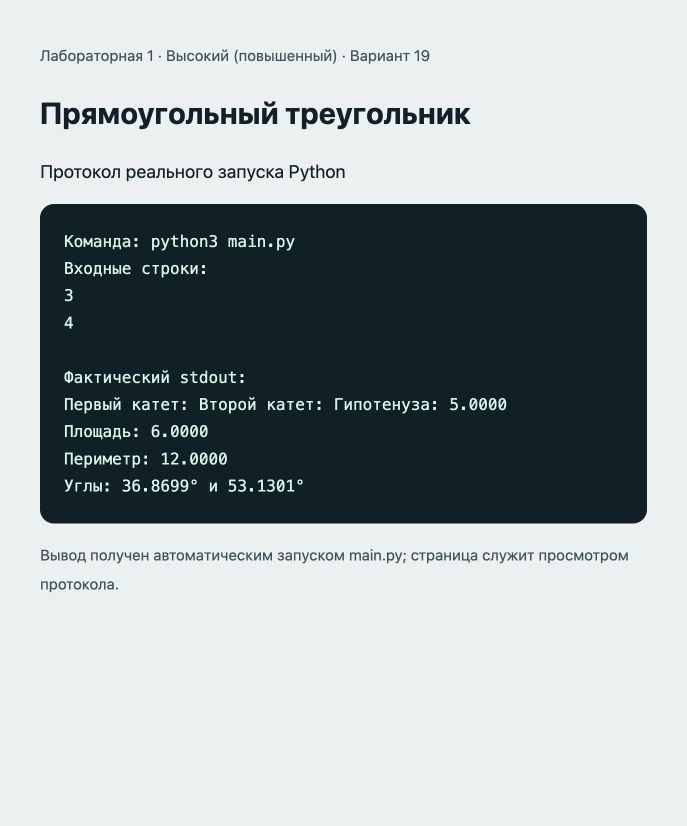

# Отчёт · Лабораторная работа №1

Дисциплина: «Языки и технология программирования».

Тема: Основы Python и линейные алгоритмы.

Уровень: **Высокий (повышенный)**. Вариант: **19**.

ФИО: не указано. Группа: не указана. Эти два поля следует заполнить перед сдачей.

## Цель и постановка задачи

Применить math в линейной программе.

Прямоугольный треугольник. Гипотенуза sqrt(a²+b²), площадь ab/2, периметр a+b+c. Угол A = degrees(atan2(a,b)), B = 90 − A.

## Алгоритм и данные

Гипотенуза sqrt(a²+b²), площадь ab/2, периметр a+b+c. Угол A = degrees(atan2(a,b)), B = 90 − A.

Предусловие: оба катета положительны, единицы измерения одинаковы.

Десятичные числа вводятся через точку. Неверный тип ввода приведёт к ValueError: обработка ошибок и ветвление намеренно не добавлены из-за ограничений лабораторной.

## Запуск и структура

Выполнить в этой папке команду ниже.

```sh
python3 main.py
```

[main.py](main.py).

## Проверки

Проверено 21.10.2026. Python: автоматические тесты стандартной библиотеки; веб: действия в браузере через локальный HTTP-сервер.

| № | Действие / вход | Ожидалось | Фактически | Статус |
|---|---|---|---|---|
| 1 | Ввод: 3; 4 | 5.0000; 6.0000; 12.0000; 36.8699° и 53.1301° | Первый катет: Второй катет: Гипотенуза: 5.0000<br>Площадь: 6.0000<br>Периметр: 12.0000<br>Углы: 36.8699° и 53.1301° | Пройден |
| 2 | Ввод: 1; 1 | 1.4142; 0.5000; 3.4142; 45.0000° и 45.0000° | Первый катет: Второй катет: Гипотенуза: 1.4142<br>Площадь: 0.5000<br>Периметр: 3.4142<br>Углы: 45.0000° и 45.0000° | Пройден |
| 3 | Ввод: 5; 12 | 13.0000; 30.0000; 30.0000; 22.6199° и 67.3801° | Первый катет: Второй катет: Гипотенуза: 13.0000<br>Площадь: 30.0000<br>Периметр: 30.0000<br>Углы: 22.6199° и 67.3801° | Пройден |

## Демонстрация

Ниже фактический вывод `python3 main.py`. Изображение в `output.png` — снимок страницы протокола этого запуска.

```text
Команда: python3 main.py
Входные строки:
3
4

Фактический stdout:
Первый катет: Второй катет: Гипотенуза: 5.0000
Площадь: 6.0000
Периметр: 12.0000
Углы: 36.8699° и 53.1301°
```



## Исходный код

### main.py

```python
import math

# Предусловие: оба катета положительны, единицы измерения одинаковы.
leg_a = float(input("Первый катет: "))
leg_b = float(input("Второй катет: "))
hypotenuse = math.hypot(leg_a, leg_b)
area = leg_a * leg_b / 2
perimeter = leg_a + leg_b + hypotenuse
angle_a = math.degrees(math.atan2(leg_a, leg_b))
angle_b = 90 - angle_a
print(f"Гипотенуза: {hypotenuse:.4f}")
print(f"Площадь: {area:.4f}")
print(f"Периметр: {perimeter:.4f}")
print(f"Углы: {angle_a:.4f}° и {angle_b:.4f}°")
```

## Ответы для защиты

**Что возвращает input()?** Строку; для арифметики её преобразуют int() или float().

**Чем / отличается от //?** / возвращает результат деления, // — результат с округлением вниз.

**Для чего нужен %?** Для получения остатка: например, выделения минут и секунд.

**Для чего нужен math?** Для математических констант и функций: pi, hypot, atan2, degrees.

## Вывод

Реализован вариант «Прямоугольный треугольник». Гипотенуза sqrt(a²+b²), площадь ab/2, периметр a+b+c. Угол A = degrees(atan2(a,b)), B = 90 − A. Проверки, приведённые в таблице (3), пройдены.
