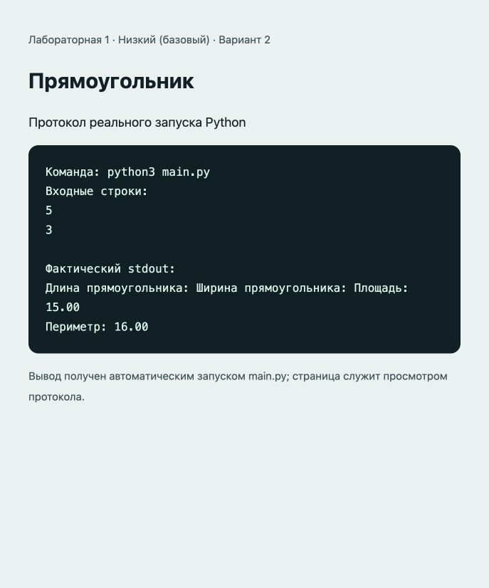

# Отчёт · Лабораторная работа №1

Дисциплина: «Языки и технология программирования».

Тема: Основы Python и линейные алгоритмы.

Уровень: **Низкий (базовый)**. Вариант: **2**.

ФИО: не указано. Группа: не указана. Эти два поля следует заполнить перед сдачей.

## Цель и постановка задачи

Ввод чисел и линейные вычисления.

Прямоугольник. Прочитать длину и ширину. Площадь S = a × b, периметр P = 2 × (a + b).

## Алгоритм и данные

Прочитать длину и ширину. Площадь S = a × b, периметр P = 2 × (a + b).

Предусловие: длина и ширина — положительные числа.

Десятичные числа вводятся через точку. Неверный тип ввода приведёт к ValueError: обработка ошибок и ветвление намеренно не добавлены из-за ограничений лабораторной.

## Запуск и структура

Выполнить в этой папке команду ниже.

```sh
python3 main.py
```

[main.py](main.py).

## Проверки

Проверено 21.10.2026. Python: автоматические тесты стандартной библиотеки; веб: действия в браузере через локальный HTTP-сервер.

| № | Действие / вход | Ожидалось | Фактически | Статус |
|---|---|---|---|---|
| 1 | Ввод: 5; 3 | 15.00; 16.00 | Длина прямоугольника: Ширина прямоугольника: Площадь: 15.00<br>Периметр: 16.00 | Пройден |
| 2 | Ввод: 2.5; 4 | 10.00; 13.00 | Длина прямоугольника: Ширина прямоугольника: Площадь: 10.00<br>Периметр: 13.00 | Пройден |
| 3 | Ввод: 1; 1 | 1.00; 4.00 | Длина прямоугольника: Ширина прямоугольника: Площадь: 1.00<br>Периметр: 4.00 | Пройден |

## Демонстрация

Ниже фактический вывод `python3 main.py`. Изображение в `output.png` — снимок страницы протокола этого запуска.

```text
Команда: python3 main.py
Входные строки:
5
3

Фактический stdout:
Длина прямоугольника: Ширина прямоугольника: Площадь: 15.00
Периметр: 16.00
```



## Исходный код

### main.py

```python
# Лабораторная 1, базовый уровень, вариант 2.
# Предусловие: длина и ширина — положительные числа.
length = float(input("Длина прямоугольника: "))
width = float(input("Ширина прямоугольника: "))
area = length * width
perimeter = 2 * (length + width)
print(f"Площадь: {area:.2f}")
print(f"Периметр: {perimeter:.2f}")
```

## Ответы для защиты

**Что возвращает input()?** Строку; для арифметики её преобразуют int() или float().

**Чем / отличается от //?** / возвращает результат деления, // — результат с округлением вниз.

**Для чего нужен %?** Для получения остатка: например, выделения минут и секунд.

**Для чего нужен math?** Для математических констант и функций: pi, hypot, atan2, degrees.

## Вывод

Реализован вариант «Прямоугольник». Прочитать длину и ширину. Площадь S = a × b, периметр P = 2 × (a + b). Проверки, приведённые в таблице (3), пройдены.
