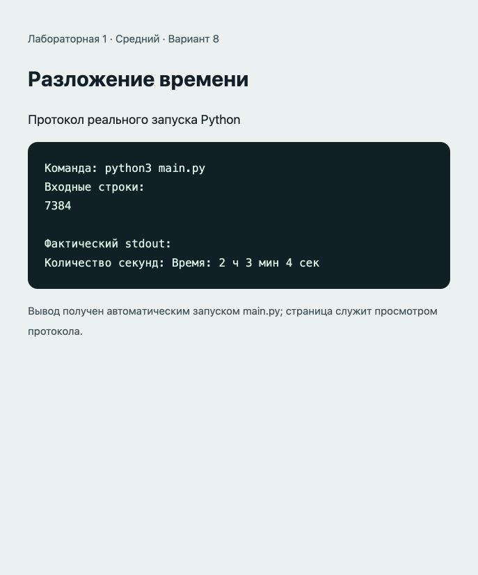

# Отчёт · Лабораторная работа №1

Дисциплина: «Языки и технология программирования».

Тема: Основы Python и линейные алгоритмы.

Уровень: **Средний**. Вариант: **8**.

ФИО: не указано. Группа: не указана. Эти два поля следует заполнить перед сдачей.

## Цель и постановка задачи

Освоить целочисленное деление и остаток.

Разложение времени. Часы = seconds // 3600; минуты = seconds % 3600 // 60; секунды = seconds % 60.

## Алгоритм и данные

Часы = seconds // 3600; минуты = seconds % 3600 // 60; секунды = seconds % 60.

Предусловие: целое неотрицательное количество секунд.

Десятичные числа вводятся через точку. Неверный тип ввода приведёт к ValueError: обработка ошибок и ветвление намеренно не добавлены из-за ограничений лабораторной.

## Запуск и структура

Выполнить в этой папке команду ниже.

```sh
python3 main.py
```

[main.py](main.py).

## Проверки

Проверено 21.10.2026. Python: автоматические тесты стандартной библиотеки; веб: действия в браузере через локальный HTTP-сервер.

| № | Действие / вход | Ожидалось | Фактически | Статус |
|---|---|---|---|---|
| 1 | Ввод: 7384 | 2 ч 3 мин 4 сек | Количество секунд: Время: 2 ч 3 мин 4 сек | Пройден |
| 2 | Ввод: 0 | 0 ч 0 мин 0 сек | Количество секунд: Время: 0 ч 0 мин 0 сек | Пройден |
| 3 | Ввод: 86400 | 24 ч 0 мин 0 сек | Количество секунд: Время: 24 ч 0 мин 0 сек | Пройден |

## Демонстрация

Ниже фактический вывод `python3 main.py`. Изображение в `output.png` — снимок страницы протокола этого запуска.

```text
Команда: python3 main.py
Входные строки:
7384

Фактический stdout:
Количество секунд: Время: 2 ч 3 мин 4 сек
```



## Исходный код

### main.py

```python
# Лабораторная 1, средний уровень, вариант 8.
# Предусловие: целое неотрицательное количество секунд.
total_seconds = int(input("Количество секунд: "))
hours = total_seconds // 3600
minutes = total_seconds % 3600 // 60
seconds = total_seconds % 60
print(f"Время: {hours} ч {minutes} мин {seconds} сек")
```

## Ответы для защиты

**Что возвращает input()?** Строку; для арифметики её преобразуют int() или float().

**Чем / отличается от //?** / возвращает результат деления, // — результат с округлением вниз.

**Для чего нужен %?** Для получения остатка: например, выделения минут и секунд.

**Для чего нужен math?** Для математических констант и функций: pi, hypot, atan2, degrees.

## Вывод

Реализован вариант «Разложение времени». Часы = seconds // 3600; минуты = seconds % 3600 // 60; секунды = seconds % 60. Проверки, приведённые в таблице (3), пройдены.
