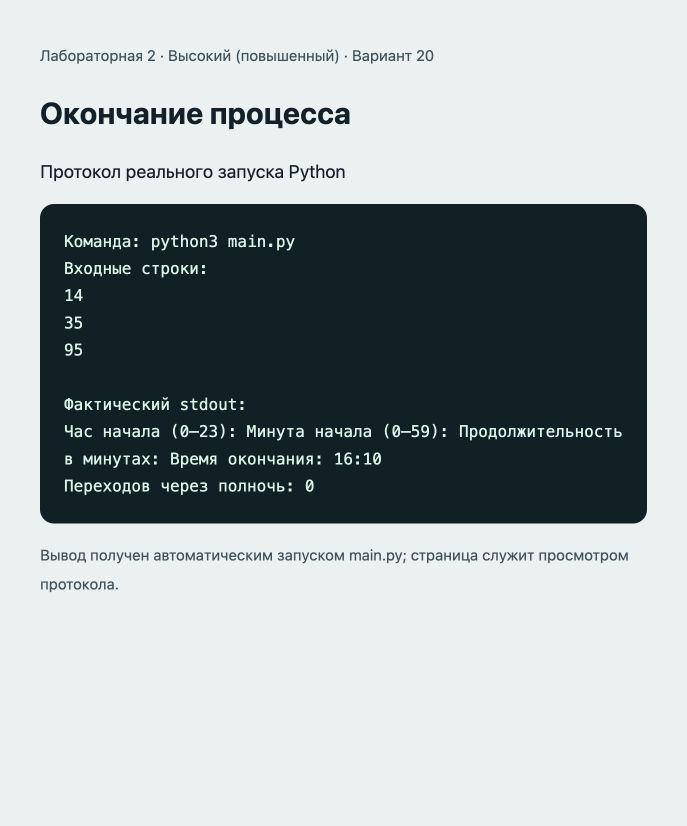

# Отчёт · Лабораторная работа №2

Дисциплина: «Языки и технология программирования».

Тема: Базовые конструкции Python.

Уровень: **Высокий (повышенный)**. Вариант: **20**.

ФИО: не указано. Группа: не указана. Эти два поля следует заполнить перед сдачей.

## Цель и постановка задачи

Использовать // и % для перехода через полночь.

Окончание процесса. Перевести начало в минуты, прибавить длительность. Часы = total // 60 % 24; минуты = total % 60.

## Алгоритм и данные

Перевести начало в минуты, прибавить длительность. Часы = total // 60 % 24; минуты = total % 60.

Предусловия: часы 0..23, минуты 0..59, длительность — целое >= 0.

Десятичные числа вводятся через точку. Неверный тип ввода приведёт к ValueError: обработка ошибок и ветвление намеренно не добавлены из-за ограничений лабораторной.

## Запуск и структура

Выполнить в этой папке команду ниже.

```sh
python3 main.py
```

[main.py](main.py).

## Проверки

Проверено 21.10.2026. Python: автоматические тесты стандартной библиотеки; веб: действия в браузере через локальный HTTP-сервер.

| № | Действие / вход | Ожидалось | Фактически | Статус |
|---|---|---|---|---|
| 1 | Ввод: 14; 35; 95 | 16:10; полночь: 0 | Час начала (0–23): Минута начала (0–59): Продолжительность в минутах: Время окончания: 16:10<br>Переходов через полночь: 0 | Пройден |
| 2 | Ввод: 23; 50; 20 | 00:10; полночь: 1 | Час начала (0–23): Минута начала (0–59): Продолжительность в минутах: Время окончания: 00:10<br>Переходов через полночь: 1 | Пройден |
| 3 | Ввод: 0; 0; 2881 | 00:01; полночь: 2 | Час начала (0–23): Минута начала (0–59): Продолжительность в минутах: Время окончания: 00:01<br>Переходов через полночь: 2 | Пройден |

## Демонстрация

Ниже фактический вывод `python3 main.py`. Изображение в `output.png` — снимок страницы протокола этого запуска.

```text
Команда: python3 main.py
Входные строки:
14
35
95

Фактический stdout:
Час начала (0–23): Минута начала (0–59): Продолжительность в минутах: Время окончания: 16:10
Переходов через полночь: 0
```



## Исходный код

### main.py

```python
# Предусловия: часы 0..23, минуты 0..59, длительность — целое >= 0.
start_hour = int(input("Час начала (0–23): "))
start_minute = int(input("Минута начала (0–59): "))
duration = int(input("Продолжительность в минутах: "))
total_minutes = start_hour * 60 + start_minute + duration
end_hour = total_minutes // 60 % 24
end_minute = total_minutes % 60
days = total_minutes // (24 * 60)
print(f"Время окончания: {end_hour:02d}:{end_minute:02d}")
print(f"Переходов через полночь: {days}")
```

## Ответы для защиты

**Что такое переменная?** Имя, связанное с объектом. Тип принадлежит объекту.

**Чем int отличается от float?** int представляет целые числа, float — числа с плавающей точкой и ограниченной точностью.

**Что делает **?** Возводит число в степень.

**Почему в этих проектах нет проверки if?** Методичка требует линейный алгоритм. Допустимые входные значения приведены в комментариях.

**Что произойдёт при int("Python")?** Возникнет ValueError, потому что строка не содержит целое число.

## Вывод

Реализован вариант «Окончание процесса». Перевести начало в минуты, прибавить длительность. Часы = total // 60 % 24; минуты = total % 60. Проверки, приведённые в таблице (3), пройдены.
