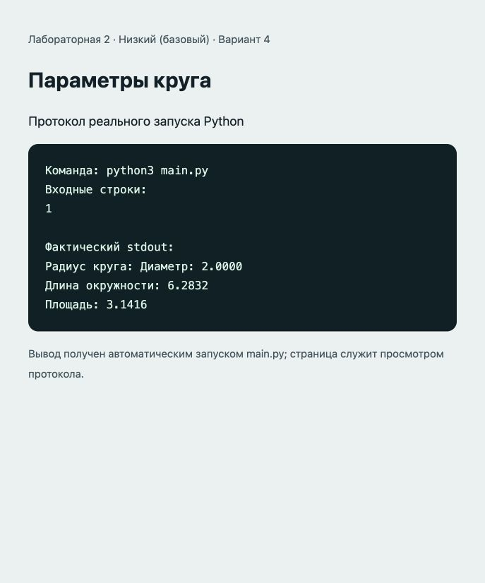

# Отчёт · Лабораторная работа №2

Дисциплина: «Языки и технология программирования».

Тема: Базовые конструкции Python.

Уровень: **Низкий (базовый)**. Вариант: **4**.

ФИО: не указано. Группа: не указана. Эти два поля следует заполнить перед сдачей.

## Цель и постановка задачи

Вычислять геометрические величины с math.pi.

Параметры круга. Диаметр 2r; длина окружности 2πr; площадь πr².

## Алгоритм и данные

Диаметр 2r; длина окружности 2πr; площадь πr².

Предусловие: радиус — положительное число.

Десятичные числа вводятся через точку. Неверный тип ввода приведёт к ValueError: обработка ошибок и ветвление намеренно не добавлены из-за ограничений лабораторной.

## Запуск и структура

Выполнить в этой папке команду ниже.

```sh
python3 main.py
```

[main.py](main.py).

## Проверки

Проверено 21.10.2026. Python: автоматические тесты стандартной библиотеки; веб: действия в браузере через локальный HTTP-сервер.

| № | Действие / вход | Ожидалось | Фактически | Статус |
|---|---|---|---|---|
| 1 | Ввод: 1 | 2.0000; 6.2832; 3.1416 | Радиус круга: Диаметр: 2.0000<br>Длина окружности: 6.2832<br>Площадь: 3.1416 | Пройден |
| 2 | Ввод: 2 | 4.0000; 12.5664; 12.5664 | Радиус круга: Диаметр: 4.0000<br>Длина окружности: 12.5664<br>Площадь: 12.5664 | Пройден |
| 3 | Ввод: 0.5 | 1.0000; 3.1416; 0.7854 | Радиус круга: Диаметр: 1.0000<br>Длина окружности: 3.1416<br>Площадь: 0.7854 | Пройден |

## Демонстрация

Ниже фактический вывод `python3 main.py`. Изображение в `output.png` — снимок страницы протокола этого запуска.

```text
Команда: python3 main.py
Входные строки:
1

Фактический stdout:
Радиус круга: Диаметр: 2.0000
Длина окружности: 6.2832
Площадь: 3.1416
```



## Исходный код

### main.py

```python
import math

# Предусловие: радиус — положительное число.
radius = float(input("Радиус круга: "))
diameter = 2 * radius
circumference = 2 * math.pi * radius
area = math.pi * radius ** 2
print(f"Диаметр: {diameter:.4f}")
print(f"Длина окружности: {circumference:.4f}")
print(f"Площадь: {area:.4f}")
```

## Ответы для защиты

**Что такое переменная?** Имя, связанное с объектом. Тип принадлежит объекту.

**Чем int отличается от float?** int представляет целые числа, float — числа с плавающей точкой и ограниченной точностью.

**Что делает **?** Возводит число в степень.

**Почему в этих проектах нет проверки if?** Методичка требует линейный алгоритм. Допустимые входные значения приведены в комментариях.

**Что произойдёт при int("Python")?** Возникнет ValueError, потому что строка не содержит целое число.

## Вывод

Реализован вариант «Параметры круга». Диаметр 2r; длина окружности 2πr; площадь πr². Проверки, приведённые в таблице (3), пройдены.
