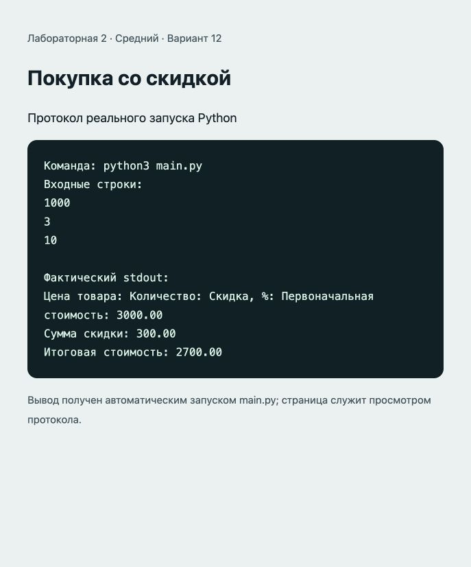

# Отчёт · Лабораторная работа №2

Дисциплина: «Языки и технология программирования».

Тема: Базовые конструкции Python.

Уровень: **Средний**. Вариант: **12**.

ФИО: не указано. Группа: не указана. Эти два поля следует заполнить перед сдачей.

## Цель и постановка задачи

Применять процентные вычисления.

Покупка со скидкой. Стоимость = цена × количество; скидка = стоимость × процент / 100; итог = стоимость − скидка.

## Алгоритм и данные

Стоимость = цена × количество; скидка = стоимость × процент / 100; итог = стоимость − скидка.

Предусловия: цена >= 0, количество — целое >= 0, скидка от 0 до 100.

Десятичные числа вводятся через точку. Неверный тип ввода приведёт к ValueError: обработка ошибок и ветвление намеренно не добавлены из-за ограничений лабораторной.

## Запуск и структура

Выполнить в этой папке команду ниже.

```sh
python3 main.py
```

[main.py](main.py).

## Проверки

Проверено 21.10.2026. Python: автоматические тесты стандартной библиотеки; веб: действия в браузере через локальный HTTP-сервер.

| № | Действие / вход | Ожидалось | Фактически | Статус |
|---|---|---|---|---|
| 1 | Ввод: 1000; 3; 10 | 3000.00; 300.00; 2700.00 | Цена товара: Количество: Скидка, %: Первоначальная стоимость: 3000.00<br>Сумма скидки: 300.00<br>Итоговая стоимость: 2700.00 | Пройден |
| 2 | Ввод: 250; 2; 0 | 500.00; 0.00; 500.00 | Цена товара: Количество: Скидка, %: Первоначальная стоимость: 500.00<br>Сумма скидки: 0.00<br>Итоговая стоимость: 500.00 | Пройден |
| 3 | Ввод: 150; 4; 100 | 600.00; 600.00; 0.00 | Цена товара: Количество: Скидка, %: Первоначальная стоимость: 600.00<br>Сумма скидки: 600.00<br>Итоговая стоимость: 0.00 | Пройден |

## Демонстрация

Ниже фактический вывод `python3 main.py`. Изображение в `output.png` — снимок страницы протокола этого запуска.

```text
Команда: python3 main.py
Входные строки:
1000
3
10

Фактический stdout:
Цена товара: Количество: Скидка, %: Первоначальная стоимость: 3000.00
Сумма скидки: 300.00
Итоговая стоимость: 2700.00
```



## Исходный код

### main.py

```python
# Предусловия: цена >= 0, количество — целое >= 0, скидка от 0 до 100.
price = float(input("Цена товара: "))
quantity = int(input("Количество: "))
discount_percent = float(input("Скидка, %: "))
subtotal = price * quantity
discount = subtotal * discount_percent / 100
total = subtotal - discount
print(f"Первоначальная стоимость: {subtotal:.2f}")
print(f"Сумма скидки: {discount:.2f}")
print(f"Итоговая стоимость: {total:.2f}")
```

## Ответы для защиты

**Что такое переменная?** Имя, связанное с объектом. Тип принадлежит объекту.

**Чем int отличается от float?** int представляет целые числа, float — числа с плавающей точкой и ограниченной точностью.

**Что делает **?** Возводит число в степень.

**Почему в этих проектах нет проверки if?** Методичка требует линейный алгоритм. Допустимые входные значения приведены в комментариях.

**Что произойдёт при int("Python")?** Возникнет ValueError, потому что строка не содержит целое число.

## Вывод

Реализован вариант «Покупка со скидкой». Стоимость = цена × количество; скидка = стоимость × процент / 100; итог = стоимость − скидка. Проверки, приведённые в таблице (3), пройдены.
