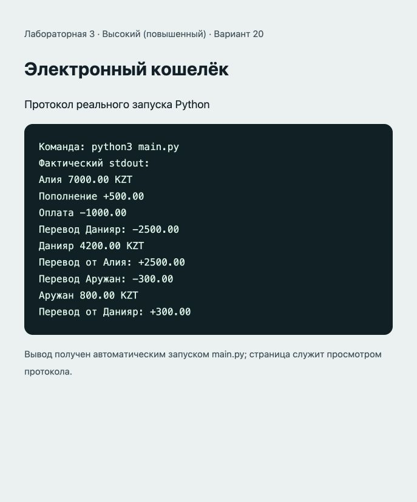

# Отчёт · Лабораторная работа №3

Дисциплина: «Языки и технология программирования».

Тема: Основы ООП.

Уровень: **Высокий (повышенный)**. Вариант: **20**.

ФИО: не указано. Группа: не указана. Эти два поля следует заполнить перед сдачей.

## Цель и постановка задачи

Объединить инкапсуляцию и взаимодействие объектов.

Электронный кошелёк. Проверить PIN и сумму до изменения баланса. Перевод проверяет получателя и валюту, затем изменяет оба кошелька и истории.

## Алгоритм и данные

Проверить PIN и сумму до изменения баланса. Перевод проверяет получателя и валюту, затем изменяет оба кошелька и истории.

Класс `ElectronicWallet`. Атрибуты: `__balance`, `__history`, `__pin`, `currency`, `owner`. Методы: `__init__()`, `_validate_pin()`, `check_pin()`, `_authorize()`, `get_balance()`, `deposit()`, `pay()`, `transfer()`, `get_history()`, `change_pin()`.

В `main()` создаются три объекта и демонстрируется изменение состояния.

## Запуск и структура

Выполнить в этой папке команду ниже.

```sh
python3 main.py
```

[main.py](main.py).

## Проверки

Проверено 21.10.2026. Python: автоматические тесты стандартной библиотеки; веб: действия в браузере через локальный HTTP-сервер.

| № | Действие / вход | Ожидалось | Фактически | Статус |
|---|---|---|---|---|
| 1 | Перевод 20.25 между балансами 100 и 50 | 79.75 и 70.25; две истории | Оба баланса и истории соответствуют ожиданиям | Пройден |
| 2 | Перевод с неверным PIN | PermissionError без изменения балансов | Баланс отправителя 100, получателя 0 | Пройден |
| 3 | Перевод себе, другому типу объекта или другой валюте | ValueError без изменения баланса | Баланс отправителя 100 | Пройден |
| 4 | Пополнение 20, оплата 30, смена PIN | Баланс 90, старый PIN не действует | 90; доступ по новому PIN | Пройден |
| 5 | Оплата 101 при балансе 100 | Отказ без изменения баланса | ValueError; баланс 100 | Пройден |

## Демонстрация

Ниже фактический вывод `python3 main.py`. Изображение в `output.png` — снимок страницы протокола этого запуска.

```text
Команда: python3 main.py
Фактический stdout:
Алия 7000.00 KZT
Пополнение +500.00
Оплата -1000.00
Перевод Данияр: -2500.00
Данияр 4200.00 KZT
Перевод от Алия: +2500.00
Перевод Аружан: -300.00
Аружан 800.00 KZT
Перевод от Данияр: +300.00
```



## Исходный код

### main.py

```python
from decimal import Decimal, InvalidOperation

def money(value, allow_zero=False):
    """Проверяет сумму и сохраняет точность до тиына (два знака)."""
    try:
        amount = Decimal(str(value))
    except (InvalidOperation, ValueError):
        raise ValueError("Введите числовую сумму") from None
    if not amount.is_finite() or amount < 0 or (amount == 0 and not allow_zero):
        raise ValueError("Сумма должна быть положительной и конечной")
    if amount != amount.quantize(Decimal("0.01")):
        raise ValueError("Допускается не более двух знаков после запятой")
    return amount.quantize(Decimal("0.01"))


class ElectronicWallet:
    """Учебный кошелёк. Не является платёжной системой."""
    def __init__(self, owner, pin, balance=0, currency="KZT"):
        self._validate_pin(pin)
        if not owner.strip():
            raise ValueError("Укажите владельца")
        self.owner = owner.strip()
        self.currency = currency
        self.__pin = pin
        self.__balance = money(balance, allow_zero=True)
        self.__history = []

    @staticmethod
    def _validate_pin(pin):
        if not isinstance(pin, str) or len(pin) != 4 or not pin.isascii() or not pin.isdigit():
            raise ValueError("PIN должен содержать ровно четыре цифры")

    def check_pin(self, pin):
        return self.__pin == pin

    def _authorize(self, pin):
        if not self.check_pin(pin):
            raise PermissionError("Неверный PIN")

    def get_balance(self, pin):
        self._authorize(pin)
        return self.__balance

    def deposit(self, amount, pin):
        self._authorize(pin)
        amount = money(amount)
        self.__balance += amount
        self.__history.append(f"Пополнение +{amount}")

    def pay(self, amount, pin):
        self._authorize(pin)
        amount = money(amount)
        if amount > self.__balance:
            raise ValueError("Недостаточно средств")
        self.__balance -= amount
        self.__history.append(f"Оплата -{amount}")

    def transfer(self, recipient, amount, pin):
        self._authorize(pin)
        amount = money(amount)
        if not isinstance(recipient, ElectronicWallet) or recipient is self:
            raise ValueError("Нужен другой кошелёк получателя")
        if recipient.currency != self.currency:
            raise ValueError("Валюты кошельков должны совпадать")
        if amount > self.__balance:
            raise ValueError("Недостаточно средств")
        # Все проверки завершены до изменения двух балансов.
        self.__balance -= amount
        recipient.__balance += amount
        self.__history.append(f"Перевод {recipient.owner}: -{amount}")
        recipient.__history.append(f"Перевод от {self.owner}: +{amount}")

    def get_history(self, pin):
        self._authorize(pin)
        return tuple(self.__history)

    def change_pin(self, old_pin, new_pin):
        self._authorize(old_pin)
        self._validate_pin(new_pin)
        self.__pin = new_pin

def main():
    # Вымышленные демонстрационные PIN, не реальные секреты.
    first = ElectronicWallet("Алия", "1111", 10000)
    second = ElectronicWallet("Данияр", "2222", 2000)
    third = ElectronicWallet("Аружан", "3333", 500)
    first.deposit(500, "1111")
    first.pay(1000, "1111")
    first.transfer(second, 2500, "1111")
    second.transfer(third, 300, "2222")
    for wallet, pin in [(first, "1111"), (second, "2222"), (third, "3333")]:
        print(wallet.owner, wallet.get_balance(pin), wallet.currency)
        print(*wallet.get_history(pin), sep="\n")

if __name__ == "__main__":
    main()
```

## Дополнительная возможность

Атрибут currency и метод change_pin(). PIN используется только в памяти учебной программы.

## Ответы для защиты

**Что такое класс и объект?** Класс описывает данные и поведение; объект — конкретный экземпляр класса.

**Для чего нужны __init__ и self?** __init__ инициализирует экземпляр; self — ссылка на текущий экземпляр.

**Что означает __balance?** Python изменяет имя атрибута (name mangling), затрудняя случайный доступ. Это не криптографическая защита.

**Зачем изменять баланс через методы?** Методы проверяют сумму и остаток до изменения состояния.

**Почему Decimal?** Он позволяет точно складывать десятичные суммы, например 0.1 и 0.2.

## Вывод

Реализован вариант «Электронный кошелёк». Проверить PIN и сумму до изменения баланса. Перевод проверяет получателя и валюту, затем изменяет оба кошелька и истории. Проверки, приведённые в таблице (5), пройдены.
