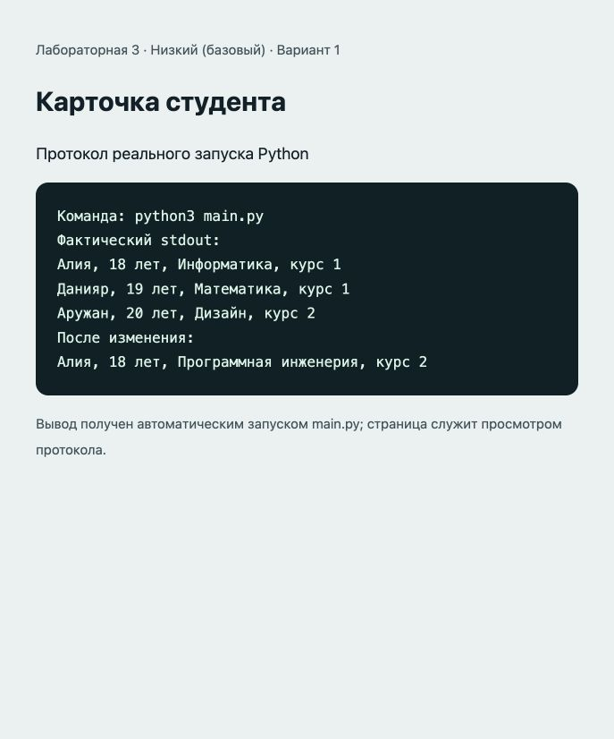

# Отчёт · Лабораторная работа №3

Дисциплина: «Языки и технология программирования».

Тема: Основы ООП.

Уровень: **Низкий (базовый)**. Вариант: **1**.

ФИО: не указано. Группа: не указана. Эти два поля следует заполнить перед сдачей.

## Цель и постановка задачи

Создавать классы, объекты и изменять их состояние.

Карточка студента. Student хранит имя, возраст и специальность; методы возвращают описание и изменяют специальность/курс.

## Алгоритм и данные

Student хранит имя, возраст и специальность; методы возвращают описание и изменяют специальность/курс.

Класс `Student`. Атрибуты: `age`, `course`, `name`, `specialty`. Методы: `__init__()`, `get_info()`, `print_info()`, `change_specialty()`, `advance_course()`.

В `main()` создаются три объекта и демонстрируется изменение состояния.

## Запуск и структура

Выполнить в этой папке команду ниже.

```sh
python3 main.py
```

[main.py](main.py).

## Проверки

Проверено 21.10.2026. Python: автоматические тесты стандартной библиотеки; веб: действия в браузере через локальный HTTP-сервер.

| № | Действие / вход | Ожидалось | Фактически | Статус |
|---|---|---|---|---|
| 1 | Три независимых объекта; смена специальности первого | Меняется только первый объект | Три объекта созданы; специальность второго осталась IT | Пройден |
| 2 | Переход на следующий курс | Курс 2 | Курс 2 в состоянии и описании | Пройден |
| 3 | Пустое имя, отрицательный возраст, переход после курса 6 | ValueError | Все три некорректных действия отклонены | Пройден |

## Демонстрация

Ниже фактический вывод `python3 main.py`. Изображение в `output.png` — снимок страницы протокола этого запуска.

```text
Команда: python3 main.py
Фактический stdout:
Алия, 18 лет, Информатика, курс 1
Данияр, 19 лет, Математика, курс 1
Аружан, 20 лет, Дизайн, курс 2
После изменения:
Алия, 18 лет, Программная инженерия, курс 2
```



## Исходный код

### main.py

```python
class Student:
    """Студент: данные экземпляра и методы изменения состояния."""

    def __init__(self, name, age, specialty, course=1):
        if not name.strip() or not specialty.strip():
            raise ValueError("Имя и специальность обязательны")
        if type(age) is not int or not 1 <= age <= 120:
            raise ValueError("Возраст должен быть целым от 1 до 120")
        if type(course) is not int or not 1 <= course <= 6:
            raise ValueError("Курс должен быть целым от 1 до 6")
        self.name = name.strip()
        self.age = age
        self.specialty = specialty.strip()
        self.course = course

    def get_info(self):
        return f"{self.name}, {self.age} лет, {self.specialty}, курс {self.course}"

    def print_info(self):
        print(self.get_info())

    def change_specialty(self, specialty):
        if not specialty.strip():
            raise ValueError("Специальность не может быть пустой")
        self.specialty = specialty.strip()

    def advance_course(self):
        if self.course >= 6:
            raise ValueError("Последний курс уже достигнут")
        self.course += 1

def main():
    students = [Student("Алия", 18, "Информатика"),
                Student("Данияр", 19, "Математика"),
                Student("Аружан", 20, "Дизайн", 2)]
    for student in students:
        student.print_info()
    students[0].change_specialty("Программная инженерия")
    students[0].advance_course()
    print("После изменения:")
    students[0].print_info()

if __name__ == "__main__":
    main()
```

## Дополнительная возможность

Дополнительный атрибут course и метод advance_course().

## Ответы для защиты

**Что такое класс и объект?** Класс описывает данные и поведение; объект — конкретный экземпляр класса.

**Для чего нужны __init__ и self?** __init__ инициализирует экземпляр; self — ссылка на текущий экземпляр.

**Что означает __balance?** Python изменяет имя атрибута (name mangling), затрудняя случайный доступ. Это не криптографическая защита.

**Зачем изменять баланс через методы?** Методы проверяют сумму и остаток до изменения состояния.

**Почему Decimal?** Он позволяет точно складывать десятичные суммы, например 0.1 и 0.2.

## Вывод

Реализован вариант «Карточка студента». Student хранит имя, возраст и специальность; методы возвращают описание и изменяют специальность/курс. Проверки, приведённые в таблице (3), пройдены.
