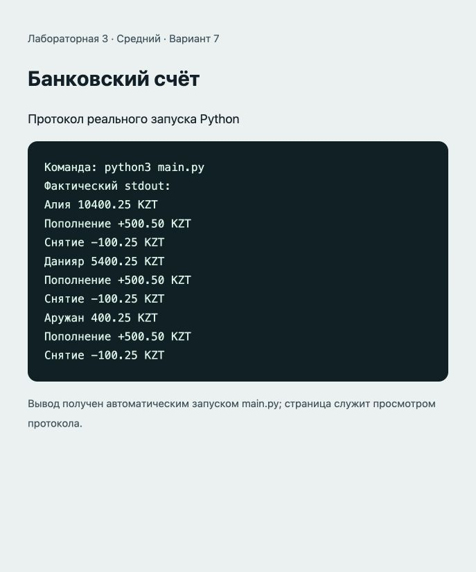

# Отчёт · Лабораторная работа №3

Дисциплина: «Языки и технология программирования».

Тема: Основы ООП.

Уровень: **Средний**. Вариант: **7**.

ФИО: не указано. Группа: не указана. Эти два поля следует заполнить перед сдачей.

## Цель и постановка задачи

Применять инкапсуляцию и проверку операций.

Банковский счёт. BankAccount скрывает __balance. Пополнение и снятие проверяют сумму, снятие проверяет остаток.

## Алгоритм и данные

BankAccount скрывает __balance. Пополнение и снятие проверяют сумму, снятие проверяет остаток.

Класс `BankAccount`. Атрибуты: `__balance`, `__history`, `currency`, `owner`. Методы: `__init__()`, `get_balance()`, `deposit()`, `withdraw()`, `get_statement()`.

В `main()` создаются три объекта и демонстрируется изменение состояния.

## Запуск и структура

Выполнить в этой папке команду ниже.

```sh
python3 main.py
```

[main.py](main.py).

## Проверки

Проверено 21.10.2026. Python: автоматические тесты стандартной библиотеки; веб: действия в браузере через локальный HTTP-сервер.

| № | Действие / вход | Ожидалось | Фактически | Статус |
|---|---|---|---|---|
| 1 | 0.10 + 0.20 − 0.10 | Баланс 0.20; две записи истории | Decimal 0.20; две записи | Пройден |
| 2 | Снятие 101 при балансе 100 | Отказ без изменения состояния | ValueError; баланс 100; история пуста | Пройден |
| 3 | Пополнение −1, 0, NaN, Infinity, text, 0.001 | Все операции отклонены | ValueError; баланс остался 0 | Пройден |

## Демонстрация

Ниже фактический вывод `python3 main.py`. Изображение в `output.png` — снимок страницы протокола этого запуска.

```text
Команда: python3 main.py
Фактический stdout:
Алия 10400.25 KZT
Пополнение +500.50 KZT
Снятие -100.25 KZT
Данияр 5400.25 KZT
Пополнение +500.50 KZT
Снятие -100.25 KZT
Аружан 400.25 KZT
Пополнение +500.50 KZT
Снятие -100.25 KZT
```



## Исходный код

### main.py

```python
from decimal import Decimal, InvalidOperation

def money(value, allow_zero=False):
    """Проверяет сумму и сохраняет точность до тиына (два знака)."""
    try:
        amount = Decimal(str(value))
    except (InvalidOperation, ValueError):
        raise ValueError("Введите числовую сумму") from None
    if not amount.is_finite() or amount < 0 or (amount == 0 and not allow_zero):
        raise ValueError("Сумма должна быть положительной и конечной")
    if amount != amount.quantize(Decimal("0.01")):
        raise ValueError("Допускается не более двух знаков после запятой")
    return amount.quantize(Decimal("0.01"))


class BankAccount:
    def __init__(self, owner, balance=0, currency="KZT"):
        if not owner.strip():
            raise ValueError("Укажите владельца")
        self.owner = owner.strip()
        self.currency = currency
        self.__balance = money(balance, allow_zero=True)
        self.__history = []

    def get_balance(self):
        return self.__balance

    def deposit(self, amount):
        amount = money(amount)
        self.__balance += amount
        self.__history.append(f"Пополнение +{amount} {self.currency}")

    def withdraw(self, amount):
        amount = money(amount)
        if amount > self.__balance:
            raise ValueError("Недостаточно средств")
        self.__balance -= amount
        self.__history.append(f"Снятие -{amount} {self.currency}")

    def get_statement(self):
        return tuple(self.__history)

def main():
    accounts = [BankAccount("Алия", 10000), BankAccount("Данияр", 5000), BankAccount("Аружан")]
    for account in accounts:
        account.deposit("500.50")
        account.withdraw("100.25")
        print(account.owner, account.get_balance(), account.currency)
        print(*account.get_statement(), sep="\n")

if __name__ == "__main__":
    main()
```

## Дополнительная возможность

Атрибут currency и метод get_statement() с историей операций. Учебная модель без подключения к банку.

## Ответы для защиты

**Что такое класс и объект?** Класс описывает данные и поведение; объект — конкретный экземпляр класса.

**Для чего нужны __init__ и self?** __init__ инициализирует экземпляр; self — ссылка на текущий экземпляр.

**Что означает __balance?** Python изменяет имя атрибута (name mangling), затрудняя случайный доступ. Это не криптографическая защита.

**Зачем изменять баланс через методы?** Методы проверяют сумму и остаток до изменения состояния.

**Почему Decimal?** Он позволяет точно складывать десятичные суммы, например 0.1 и 0.2.

## Вывод

Реализован вариант «Банковский счёт». BankAccount скрывает __balance. Пополнение и снятие проверяют сумму, снятие проверяет остаток. Проверки, приведённые в таблице (3), пройдены.
