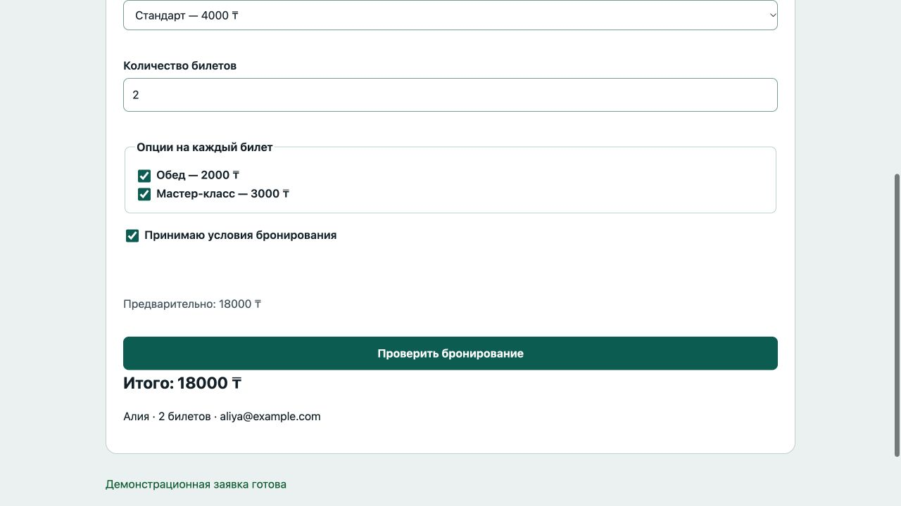

# Отчёт · Лабораторная работа №4

Дисциплина: «Языки и технология программирования».

Тема: Формы и клиентская валидация.

Уровень: **Высокий (повышенный)**. Вариант: **18**.

ФИО: не указано. Группа: не указана. Эти два поля следует заполнить перед сдачей.

## Цель и постановка задачи

Соберите заявку и узнайте стоимость билетов.

Бронирование мероприятия. Проверить контактные данные, категорию, количество 1–10 и согласие. Стоимость = (цена билета + опции на билет) × количество.

## Алгоритм и данные

Проверить контактные данные, категорию, количество 1–10 и согласие. Стоимость = (цена билета + опции на билет) × количество.

Ввод осуществляется через подписанные поля и кнопки. Пользовательский текст выводится через `textContent`. Ошибки показываются на странице, перезагрузка для выполнения действия не требуется.

## Запуск и структура

Выполнить в этой папке команду ниже, затем открыть http://localhost:8000. Остановить сервер: Ctrl+C.

```sh
python3 -m http.server 8000
```

[index.html](index.html), [script.js](script.js), [style.css](style.css).

## Проверки

Проверено 21.10.2026. Python: автоматические тесты стандартной библиотеки; веб: действия в браузере через локальный HTTP-сервер.

| № | Действие / вход | Ожидалось | Фактически | Статус |
|---|---|---|---|---|
| 1 | Пустая форма | Введите ФИО | Введите ФИО | Пройден |
| 2 | Неверный e-mail | корректный e-mail | Введите корректный e-mail | Пройден |
| 3 | 11 билетов | от 1 до 10 | Количество должно быть целым от 1 до 10 | Пройден |
| 4 | Нет согласия | Подтвердите условия | Подтвердите условия | Пройден |
| 5 | 2 стандартных билета с обедом и мастер-классом | 18000 ₸ | Итого: 18000 ₸<br><br>Алия · 2 билетов · aliya@example.com | Пройден |

## Демонстрация




## Исходный код

### index.html

```html
<!doctype html>
<html lang="ru"><head><meta charset="utf-8"><meta name="viewport" content="width=device-width,initial-scale=1">
<title>Бронирование мероприятия · Лабораторная 4</title><link rel="stylesheet" href="style.css"><script src="script.js" defer></script></head>
<body><header><div class="eyebrow">Лабораторная 04 / Высокий (повышенный)</div><h1>Бронирование мероприятия</h1><p class="lead">Соберите заявку и узнайте стоимость билетов.</p><span class="badge">Вариант 18</span></header>
<main><section class="panel"><form novalidate><div class="grid"><div><label for="name">ФИО</label><input id="name" name="name" type="text"  aria-describedby="name-error"><span class="error" id="name-error"></span></div><div><label for="email">E-mail</label><input id="email" name="email" type="email"  aria-describedby="email-error"><span class="error" id="email-error"></span></div></div><div><label for="category">Категория билета</label><select id="category" name="category" aria-describedby="category-error"><option value="">Выберите…</option><option value="standard">Стандарт — 4000 ₸</option><option value="vip">VIP — 9000 ₸</option></select><span class="error" id="category-error"></span></div><div><label for="quantity">Количество билетов</label><input id="quantity" name="quantity" type="number" min="1" max="10" step="1" aria-describedby="quantity-error"><span class="error" id="quantity-error"></span></div><fieldset><legend>Опции на каждый билет</legend><label><input id="meal" type="checkbox">Обед — 2000 ₸</label><label><input id="workshop" type="checkbox">Мастер-класс — 3000 ₸</label></fieldset><label><input id="agree" type="checkbox">Принимаю условия бронирования</label><span id="agree-error" class="error"></span><p id="preview" class="muted">Выберите категорию и количество</p><button>Проверить бронирование</button></form><div id="summary"></div></section><p id="message" class="message" role="status" aria-live="polite"></p></main>
<footer>Языки и технология программирования · Учебный проект · Все данные демонстрационные</footer></body></html>
```

### script.js

```javascript
"use strict";
const $ = (selector) => document.querySelector(selector);
function element(tag, text, className = "") {
  const node = document.createElement(tag);
  node.textContent = text;
  if (className) node.className = className;
  return node;
}
function button(text, action, className = "secondary") {
  const node = element("button", text, className);
  node.type = "button";
  node.addEventListener("click", action);
  return node;
}
function message(text, success = false) {
  $("#message").textContent = text;
  $("#message").className = success ? "message success" : "message error";
}

function error(id, text) {
  $("#" + id + "-error").textContent = text;
  $("#" + id).setAttribute("aria-invalid", String(Boolean(text)));
  return !text;
}
function validEmail(value) { return /^[^\s@]+@[^\s@]+\.[^\s@]+$/.test(value); }
$("form").addEventListener("input", () => { $("#summary").replaceChildren(); message(""); });

function calculate() {
  const prices = {standard:4000, vip:9000};
  return (prices[$("#category").value] + ($("#meal").checked ? 2000 : 0) + ($("#workshop").checked ? 3000 : 0)) * Number($("#quantity").value);
}
$("form").addEventListener("input", () => {
  const q = Number($("#quantity").value);
  $("#preview").textContent = $("#category").value && Number.isInteger(q) && q >= 1 && q <= 10 ? `Предварительно: ${calculate()} ₸` : "Выберите категорию и количество от 1 до 10";
});
$("form").addEventListener("submit", (event) => {
  event.preventDefault();
  const q = Number($("#quantity").value);
  const checks = [error("name", $("#name").value.trim() ? "" : "Введите ФИО"), error("email", validEmail($("#email").value.trim()) ? "" : "Введите корректный e-mail"), error("category", $("#category").value ? "" : "Выберите категорию"), error("quantity", Number.isInteger(q) && q >= 1 && q <= 10 ? "" : "Количество должно быть целым от 1 до 10"), error("agree", $("#agree").checked ? "" : "Подтвердите условия")];
  $("#summary").replaceChildren();
  if (checks.includes(false)) { message("Исправьте отмеченные поля"); return; }
  $("#summary").append(element("h2", `Итого: ${calculate()} ₸`), element("p", `${$("#name").value.trim()} · ${q} билетов · ${$("#email").value.trim()}`));
  message("Демонстрационная заявка готова", true);
});
```

Оформление вынесено в [style.css](style.css).

## Дополнительная возможность

Мгновенный предварительный расчёт при изменении опций.

## Ответы для защиты

**Что делает preventDefault()?** Отменяет стандартную отправку формы и перезагрузку страницы.

**Чем checkbox отличается от radio?** Checkbox — независимый выбор; radio с одним name — один вариант из группы.

**Как читать поля?** value возвращает значение, checked — состояние checkbox/radio.

**Достаточно ли проверки на клиенте?** Нет. В реальном приложении сервер повторяет проверки. Здесь серверной отправки нет.

## Вывод

Реализован вариант «Бронирование мероприятия». Проверить контактные данные, категорию, количество 1–10 и согласие. Стоимость = (цена билета + опции на билет) × количество. Проверки, приведённые в таблице (5), пройдены.
