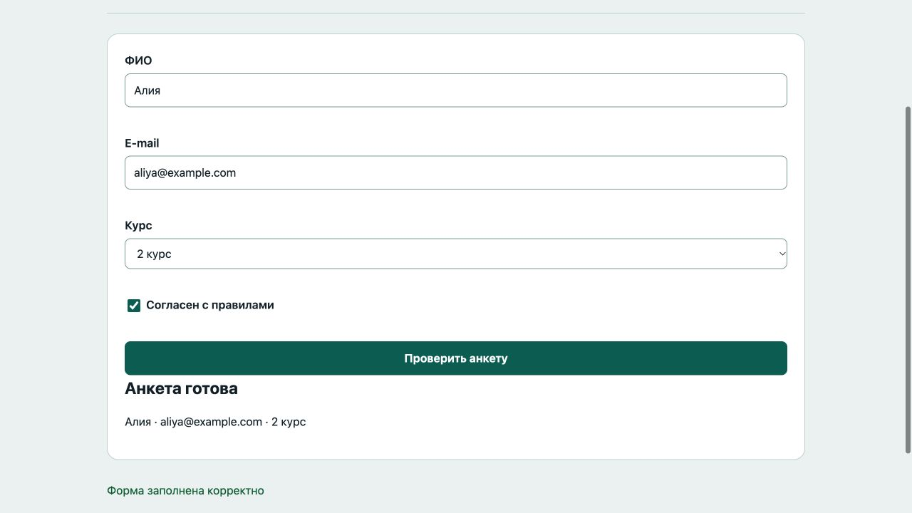

# Отчёт · Лабораторная работа №4

Дисциплина: «Языки и технология программирования».

Тема: Формы и клиентская валидация.

Уровень: **Низкий (базовый)**. Вариант: **1**.

ФИО: не указано. Группа: не указана. Эти два поля следует заполнить перед сдачей.

## Цель и постановка задачи

Заполните анкету и проверьте её без перезагрузки страницы.

Регистрация студента. При submit проверить ФИО, e-mail, курс и согласие. Все ошибки показать рядом с полями.

## Алгоритм и данные

При submit проверить ФИО, e-mail, курс и согласие. Все ошибки показать рядом с полями.

Ввод осуществляется через подписанные поля и кнопки. Пользовательский текст выводится через `textContent`. Ошибки показываются на странице, перезагрузка для выполнения действия не требуется.

## Запуск и структура

Выполнить в этой папке команду ниже, затем открыть http://localhost:8000. Остановить сервер: Ctrl+C.

```sh
python3 -m http.server 8000
```

[index.html](index.html), [script.js](script.js), [style.css](style.css).

## Проверки

Проверено 21.10.2026. Python: автоматические тесты стандартной библиотеки; веб: действия в браузере через локальный HTTP-сервер.

| № | Действие / вход | Ожидалось | Фактически | Статус |
|---|---|---|---|---|
| 1 | Пустая форма | Введите ФИО | Введите ФИО | Пройден |
| 2 | Неверный e-mail | Введите корректный e-mail | Введите корректный e-mail | Пройден |
| 3 | Курс не выбран | Выберите курс | Выберите курс | Пройден |
| 4 | Нет согласия | Подтвердите согласие | Подтвердите согласие | Пройден |
| 5 | Корректная анкета | Алия · aliya@example.com · 2 курс | Анкета готова<br><br>Алия · aliya@example.com · 2 курс | Пройден |

## Демонстрация




## Исходный код

### index.html

```html
<!doctype html>
<html lang="ru"><head><meta charset="utf-8"><meta name="viewport" content="width=device-width,initial-scale=1">
<title>Регистрация студента · Лабораторная 4</title><link rel="stylesheet" href="style.css"><script src="script.js" defer></script></head>
<body><header><div class="eyebrow">Лабораторная 04 / Низкий (базовый)</div><h1>Регистрация студента</h1><p class="lead">Заполните анкету и проверьте её без перезагрузки страницы.</p><span class="badge">Вариант 1</span></header>
<main><section class="panel"><form novalidate><div><label for="name">ФИО</label><input id="name" name="name" type="text"  aria-describedby="name-error"><span class="error" id="name-error"></span></div><div><label for="email">E-mail</label><input id="email" name="email" type="email"  aria-describedby="email-error"><span class="error" id="email-error"></span></div><div><label for="course">Курс</label><select id="course" name="course" aria-describedby="course-error"><option value="">Выберите…</option><option value="1">1 курс</option><option value="2">2 курс</option><option value="3">3 курс</option><option value="4">4 курс</option></select><span class="error" id="course-error"></span></div><div><label><input id="agree" type="checkbox" aria-describedby="agree-error">Согласен с правилами</label><span id="agree-error" class="error"></span></div><button>Проверить анкету</button></form><div id="summary"></div></section><p id="message" class="message" role="status" aria-live="polite"></p></main>
<footer>Языки и технология программирования · Учебный проект · Все данные демонстрационные</footer></body></html>
```

### script.js

```javascript
"use strict";
const $ = (selector) => document.querySelector(selector);
function element(tag, text, className = "") {
  const node = document.createElement(tag);
  node.textContent = text;
  if (className) node.className = className;
  return node;
}
function button(text, action, className = "secondary") {
  const node = element("button", text, className);
  node.type = "button";
  node.addEventListener("click", action);
  return node;
}
function message(text, success = false) {
  $("#message").textContent = text;
  $("#message").className = success ? "message success" : "message error";
}

function error(id, text) {
  $("#" + id + "-error").textContent = text;
  $("#" + id).setAttribute("aria-invalid", String(Boolean(text)));
  return !text;
}
function validEmail(value) { return /^[^\s@]+@[^\s@]+\.[^\s@]+$/.test(value); }
$("form").addEventListener("input", () => { $("#summary").replaceChildren(); message(""); });

$("form").addEventListener("submit", (event) => {
  event.preventDefault();
  const name = $("#name").value.trim(), email = $("#email").value.trim();
  const checks = [error("name", name ? "" : "Введите ФИО"), error("email", validEmail(email) ? "" : "Введите корректный e-mail"), error("course", $("#course").value ? "" : "Выберите курс"), error("agree", $("#agree").checked ? "" : "Подтвердите согласие")];
  $("#summary").replaceChildren();
  if (checks.includes(false)) { message("Исправьте отмеченные поля"); return; }
  $("#summary").append(element("h2", "Анкета готова"), element("p", `${name} · ${email} · ${$("#course").value} курс`));
  message("Форма заполнена корректно", true);
});
```

Оформление вынесено в [style.css](style.css).

## Дополнительная возможность

Предварительный просмотр анкеты и подсветка ошибочных полей.

## Ответы для защиты

**Что делает preventDefault()?** Отменяет стандартную отправку формы и перезагрузку страницы.

**Чем checkbox отличается от radio?** Checkbox — независимый выбор; radio с одним name — один вариант из группы.

**Как читать поля?** value возвращает значение, checked — состояние checkbox/radio.

**Достаточно ли проверки на клиенте?** Нет. В реальном приложении сервер повторяет проверки. Здесь серверной отправки нет.

## Вывод

Реализован вариант «Регистрация студента». При submit проверить ФИО, e-mail, курс и согласие. Все ошибки показать рядом с полями. Проверки, приведённые в таблице (5), пройдены.
