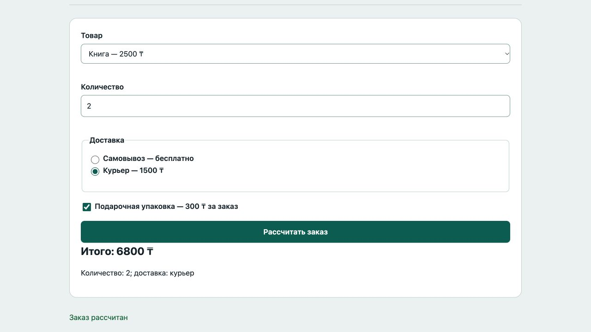

# Отчёт · Лабораторная работа №4

Дисциплина: «Языки и технология программирования».

Тема: Формы и клиентская валидация.

Уровень: **Средний**. Вариант: **8**.

ФИО: не указано. Группа: не указана. Эти два поля следует заполнить перед сдачей.

## Цель и постановка задачи

Выберите товар, доставку и дополнительные услуги.

Заказ товара. Проверить выбор товара, целое положительное количество и доставку. Рассчитать итог по выбранным опциям.

## Алгоритм и данные

Проверить выбор товара, целое положительное количество и доставку. Рассчитать итог по выбранным опциям.

Ввод осуществляется через подписанные поля и кнопки. Пользовательский текст выводится через `textContent`. Ошибки показываются на странице, перезагрузка для выполнения действия не требуется.

## Запуск и структура

Выполнить в этой папке команду ниже, затем открыть http://localhost:8000. Остановить сервер: Ctrl+C.

```sh
python3 -m http.server 8000
```

[index.html](index.html), [script.js](script.js), [style.css](style.css).

## Проверки

Проверено 21.10.2026. Python: автоматические тесты стандартной библиотеки; веб: действия в браузере через локальный HTTP-сервер.

| № | Действие / вход | Ожидалось | Фактически | Статус |
|---|---|---|---|---|
| 1 | Пустая форма | Выберите товар | Выберите товар | Пройден |
| 2 | Нулевое количество | целое количество | Введите целое количество от 1 до 1000 | Пройден |
| 3 | Дробное количество | целое количество | Введите целое количество от 1 до 1000 | Пройден |
| 4 | Доставка не выбрана | Выберите доставку | Выберите доставку | Пройден |
| 5 | 2 книги + курьер + упаковка | 6800 ₸ | Итого: 6800 ₸<br><br>Количество: 2; доставка: курьер | Пройден |

## Демонстрация




## Исходный код

### index.html

```html
<!doctype html>
<html lang="ru"><head><meta charset="utf-8"><meta name="viewport" content="width=device-width,initial-scale=1">
<title>Заказ товара · Лабораторная 4</title><link rel="stylesheet" href="style.css"><script src="script.js" defer></script></head>
<body><header><div class="eyebrow">Лабораторная 04 / Средний</div><h1>Заказ товара</h1><p class="lead">Выберите товар, доставку и дополнительные услуги.</p><span class="badge">Вариант 8</span></header>
<main><section class="panel"><form novalidate><div><label for="product">Товар</label><select id="product" name="product" aria-describedby="product-error"><option value="">Выберите…</option><option value="book">Книга — 2500 ₸</option><option value="pen">Ручка — 500 ₸</option></select><span class="error" id="product-error"></span></div><div><label for="quantity">Количество</label><input id="quantity" name="quantity" type="number" min="1" max="1000" step="1" aria-describedby="quantity-error"><span class="error" id="quantity-error"></span></div><fieldset id="delivery"><legend>Доставка</legend><label><input type="radio" name="delivery" value="pickup">Самовывоз — бесплатно</label><label><input type="radio" name="delivery" value="courier">Курьер — 1500 ₸</label><span class="error" id="delivery-error"></span></fieldset><label><input id="gift" type="checkbox">Подарочная упаковка — 300 ₸ за заказ</label><button>Рассчитать заказ</button></form><div id="summary"></div></section><p id="message" class="message" role="status" aria-live="polite"></p></main>
<footer>Языки и технология программирования · Учебный проект · Все данные демонстрационные</footer></body></html>
```

### script.js

```javascript
"use strict";
const $ = (selector) => document.querySelector(selector);
function element(tag, text, className = "") {
  const node = document.createElement(tag);
  node.textContent = text;
  if (className) node.className = className;
  return node;
}
function button(text, action, className = "secondary") {
  const node = element("button", text, className);
  node.type = "button";
  node.addEventListener("click", action);
  return node;
}
function message(text, success = false) {
  $("#message").textContent = text;
  $("#message").className = success ? "message success" : "message error";
}

function error(id, text) {
  $("#" + id + "-error").textContent = text;
  $("#" + id).setAttribute("aria-invalid", String(Boolean(text)));
  return !text;
}
function validEmail(value) { return /^[^\s@]+@[^\s@]+\.[^\s@]+$/.test(value); }
$("form").addEventListener("input", () => { $("#summary").replaceChildren(); message(""); });

$("form").addEventListener("submit", (event) => {
  event.preventDefault();
  const prices = {book:2500, pen:500}, product = $("#product").value;
  const quantity = Number($("#quantity").value), delivery = $("input[name=delivery]:checked");
  const checks = [error("product", product in prices ? "" : "Выберите товар"), error("quantity", Number.isInteger(quantity) && quantity >= 1 && quantity <= 1000 ? "" : "Введите целое количество от 1 до 1000"), error("delivery", delivery ? "" : "Выберите доставку")];
  $("#summary").replaceChildren();
  if (checks.includes(false)) { message("Исправьте отмеченные поля"); return; }
  const total = prices[product] * quantity + (delivery.value === "courier" ? 1500 : 0) + ($("#gift").checked ? 300 : 0);
  $("#summary").append(element("h2", `Итого: ${total} ₸`), element("p", `Количество: ${quantity}; доставка: ${delivery.value === "courier" ? "курьер" : "самовывоз"}`));
  message("Заказ рассчитан", true);
});
```

Оформление вынесено в [style.css](style.css).

## Дополнительная возможность

Расчёт полной стоимости с доставкой и упаковкой.

## Ответы для защиты

**Что делает preventDefault()?** Отменяет стандартную отправку формы и перезагрузку страницы.

**Чем checkbox отличается от radio?** Checkbox — независимый выбор; radio с одним name — один вариант из группы.

**Как читать поля?** value возвращает значение, checked — состояние checkbox/radio.

**Достаточно ли проверки на клиенте?** Нет. В реальном приложении сервер повторяет проверки. Здесь серверной отправки нет.

## Вывод

Реализован вариант «Заказ товара». Проверить выбор товара, целое положительное количество и доставку. Рассчитать итог по выбранным опциям. Проверки, приведённые в таблице (5), пройдены.
