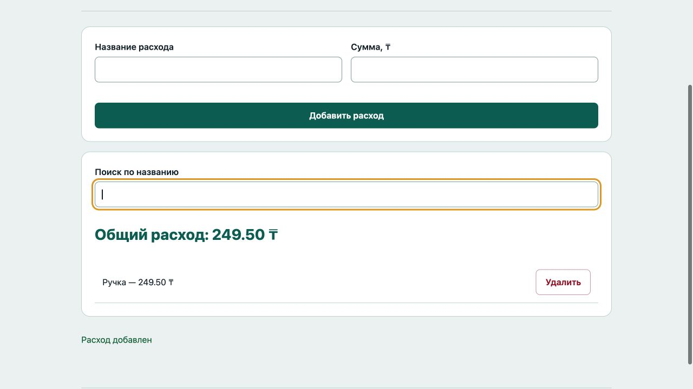

# Отчёт · Лабораторная работа №5

Дисциплина: «Языки и технология программирования».

Тема: Основы JavaScript в браузере.

Уровень: **Высокий (повышенный)**. Вариант: **20**.

ФИО: не указано. Группа: не указана. Эти два поля следует заполнить перед сдачей.

## Цель и постановка задачи

Добавляйте расходы и следите за общей суммой.

Учёт расходов. Проверить название и сумму, хранить суммы в целых тиынах. При добавлении/удалении перерисовать список циклом и пересчитать сумму.

## Алгоритм и данные

Проверить название и сумму, хранить суммы в целых тиынах. При добавлении/удалении перерисовать список циклом и пересчитать сумму.

Ввод осуществляется через подписанные поля и кнопки. Пользовательский текст выводится через `textContent`. Ошибки показываются на странице, перезагрузка для выполнения действия не требуется.

## Запуск и структура

Выполнить в этой папке команду ниже, затем открыть http://localhost:8000. Остановить сервер: Ctrl+C.

```sh
python3 -m http.server 8000
```

[index.html](index.html), [script.js](script.js), [style.css](style.css).

## Проверки

Проверено 21.10.2026. Python: автоматические тесты стандартной библиотеки; веб: действия в браузере через локальный HTTP-сервер.

| № | Действие / вход | Ожидалось | Фактически | Статус |
|---|---|---|---|---|
| 1 | Пустой расход | Укажите название | Укажите название и сумму от 0.01 до 1 000 000 000 с двумя десятичными знаками максимум | Пройден |
| 2 | Отрицательная сумма | Укажите название | Укажите название и сумму от 0.01 до 1 000 000 000 с двумя десятичными знаками максимум | Пройден |
| 3 | Сумма двух расходов | 1500.00 ₸ | Общий расход: 1500.00 ₸ | Пройден |
| 4 | Фильтр по названию | 1 | 1 | Пройден |
| 5 | Удаление расхода пересчитывает итог | 249.50 ₸ | Общий расход: 249.50 ₸ | Пройден |

## Демонстрация




## Исходный код

### index.html

```html
<!doctype html>
<html lang="ru"><head><meta charset="utf-8"><meta name="viewport" content="width=device-width,initial-scale=1">
<title>Учёт расходов · Лабораторная 5</title><link rel="stylesheet" href="style.css"><script src="script.js" defer></script></head>
<body><header><div class="eyebrow">Лабораторная 05 / Высокий (повышенный)</div><h1>Учёт расходов</h1><p class="lead">Добавляйте расходы и следите за общей суммой.</p><span class="badge">Вариант 20</span></header>
<main><section class="panel"><form novalidate><div class="grid"><div><label for="name">Название расхода</label><input id="name" name="name" type="text"  aria-describedby="name-error"><span class="error" id="name-error"></span></div><div><label for="amount">Сумма, ₸</label><input id="amount" name="amount" type="number" min="0.01" step="0.01" max="1000000000" aria-describedby="amount-error"><span class="error" id="amount-error"></span></div></div><button>Добавить расход</button></form></section><section class="panel"><label for="search">Поиск по названию</label><input id="search" type="search"><p id="total" class="stat"></p><div id="list"></div></section><p id="message" class="message" role="status" aria-live="polite"></p></main>
<footer>Языки и технология программирования · Учебный проект · Все данные демонстрационные</footer></body></html>
```

### script.js

```javascript
"use strict";
const $ = (selector) => document.querySelector(selector);
function element(tag, text, className = "") {
  const node = document.createElement(tag);
  node.textContent = text;
  if (className) node.className = className;
  return node;
}
function button(text, action, className = "secondary") {
  const node = element("button", text, className);
  node.type = "button";
  node.addEventListener("click", action);
  return node;
}
function message(text, success = false) {
  $("#message").textContent = text;
  $("#message").className = success ? "message success" : "message error";
}

let expenses = [], nextId = 1;
function render() {
  $("#list").replaceChildren(); let total = 0, visible = 0;
  const query = $("#search").value.trim().toLocaleLowerCase();
  for (const expense of expenses) {
    total += expense.cents;
    if (!expense.name.toLocaleLowerCase().includes(query)) continue;
    visible++;
    const row = element("div", "", "item");
    row.append(element("span", `${expense.name} — ${(expense.cents / 100).toFixed(2)} ₸`, "text"), button("Удалить", () => { expenses = expenses.filter((item) => item.id !== expense.id); render(); }, "danger"));
    $("#list").append(row);
  }
  $("#total").textContent = `Общий расход: ${(total / 100).toFixed(2)} ₸`;
  if (!visible) $("#list").append(element("p", "Расходы не найдены", "empty"));
}
$("form").addEventListener("submit", (event) => {
  event.preventDefault(); const name = $("#name").value.trim(), amount = Number($("#amount").value);
  if (!name || !Number.isFinite(amount) || amount <= 0 || amount > 1e9 || Math.abs(amount * 100 - Math.round(amount * 100)) > 0.0001) { message("Укажите название и сумму от 0.01 до 1 000 000 000 с двумя десятичными знаками максимум"); return; }
  expenses.push({id:nextId++, name, cents:Math.round(amount * 100)}); $("form").reset(); render(); message("Расход добавлен", true);
});
$("#search").addEventListener("input", render); render();
```

Оформление вынесено в [style.css](style.css).

## Дополнительная возможность

Поиск по названию; общий итог всегда учитывает все расходы.

## Ответы для защиты

**Чем let отличается от const?** let допускает переприсваивание, const — нет; объект в const при этом можно изменять.

**Что такое DOM?** Объектное представление документа, через которое JavaScript управляет интерфейсом.

**Зачем нужна функция?** Чтобы выделить повторяемое действие с понятным названием и параметрами.

**Как перебрать данные?** Циклом for, for…of или методом массива.

**Чем textContent отличается от value?** textContent меняет текст узла; value — текущее значение поля формы.

## Вывод

Реализован вариант «Учёт расходов». Проверить название и сумму, хранить суммы в целых тиынах. При добавлении/удалении перерисовать список циклом и пересчитать сумму. Проверки, приведённые в таблице (5), пройдены.
