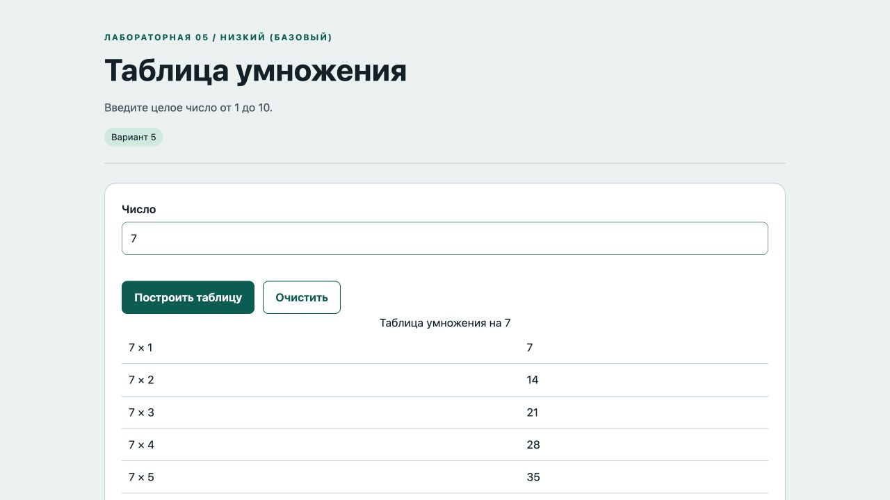

# Отчёт · Лабораторная работа №5

Дисциплина: «Языки и технология программирования».

Тема: Основы JavaScript в браузере.

Уровень: **Низкий (базовый)**. Вариант: **5**.

ФИО: не указано. Группа: не указана. Эти два поля следует заполнить перед сдачей.

## Цель и постановка задачи

Введите целое число от 1 до 10.

Таблица умножения. После проверки числа цикл for создаёт десять строк таблицы; ввод очищает старый результат.

## Алгоритм и данные

После проверки числа цикл for создаёт десять строк таблицы; ввод очищает старый результат.

Ввод осуществляется через подписанные поля и кнопки. Пользовательский текст выводится через `textContent`. Ошибки показываются на странице, перезагрузка для выполнения действия не требуется.

## Запуск и структура

Выполнить в этой папке команду ниже, затем открыть http://localhost:8000. Остановить сервер: Ctrl+C.

```sh
python3 -m http.server 8000
```

[index.html](index.html), [script.js](script.js), [style.css](style.css).

## Проверки

Проверено 21.10.2026. Python: автоматические тесты стандартной библиотеки; веб: действия в браузере через локальный HTTP-сервер.

| № | Действие / вход | Ожидалось | Фактически | Статус |
|---|---|---|---|---|
| 1 | Пустой ввод | от 1 до 10 | Введите целое число от 1 до 10 | Пройден |
| 2 | Число вне диапазона | от 1 до 10 | Введите целое число от 1 до 10 | Пройден |
| 3 | Таблица для 7: десять строк | 10 | 10 | Пройден |
| 4 | 7 × 10 | 70 | 7 × 10	70 | Пройден |

## Демонстрация




## Исходный код

### index.html

```html
<!doctype html>
<html lang="ru"><head><meta charset="utf-8"><meta name="viewport" content="width=device-width,initial-scale=1">
<title>Таблица умножения · Лабораторная 5</title><link rel="stylesheet" href="style.css"><script src="script.js" defer></script></head>
<body><header><div class="eyebrow">Лабораторная 05 / Низкий (базовый)</div><h1>Таблица умножения</h1><p class="lead">Введите целое число от 1 до 10.</p><span class="badge">Вариант 5</span></header>
<main><section class="panel"><form novalidate><div><label for="number">Число</label><input id="number" name="number" type="number" min="1" max="10" step="1" aria-describedby="number-error"><span class="error" id="number-error"></span></div><div class="row"><button>Построить таблицу</button><button type="button" id="clear" class="secondary">Очистить</button></div></form><div id="result"></div></section><p id="message" class="message" role="status" aria-live="polite"></p></main>
<footer>Языки и технология программирования · Учебный проект · Все данные демонстрационные</footer></body></html>
```

### script.js

```javascript
"use strict";
const $ = (selector) => document.querySelector(selector);
function element(tag, text, className = "") {
  const node = document.createElement(tag);
  node.textContent = text;
  if (className) node.className = className;
  return node;
}
function button(text, action, className = "secondary") {
  const node = element("button", text, className);
  node.type = "button";
  node.addEventListener("click", action);
  return node;
}
function message(text, success = false) {
  $("#message").textContent = text;
  $("#message").className = success ? "message success" : "message error";
}

function renderTable(number) {
  const table = document.createElement("table");
  table.append(element("caption", `Таблица умножения на ${number}`));
  for (let i = 1; i <= 10; i++) {
    const row = document.createElement("tr");
    row.append(element("td", `${number} × ${i}`), element("td", String(number * i)));
    table.append(row);
  }
  $("#result").replaceChildren(table);
}
$("form").addEventListener("submit", (event) => {
  event.preventDefault(); const value = Number($("#number").value);
  if (!Number.isInteger(value) || value < 1 || value > 10) {
    $("#result").replaceChildren(); message("Введите целое число от 1 до 10");
  } else { renderTable(value); message("Таблица построена", true); }
});
$("#number").addEventListener("input", () => { $("#result").replaceChildren(); message(""); });
$("#clear").addEventListener("click", () => { $("form").reset(); $("#result").replaceChildren(); message(""); $("#number").focus(); });
```

Оформление вынесено в [style.css](style.css).

## Дополнительная возможность

Очистка результата с возвратом фокуса в поле.

## Ответы для защиты

**Чем let отличается от const?** let допускает переприсваивание, const — нет; объект в const при этом можно изменять.

**Что такое DOM?** Объектное представление документа, через которое JavaScript управляет интерфейсом.

**Зачем нужна функция?** Чтобы выделить повторяемое действие с понятным названием и параметрами.

**Как перебрать данные?** Циклом for, for…of или методом массива.

**Чем textContent отличается от value?** textContent меняет текст узла; value — текущее значение поля формы.

## Вывод

Реализован вариант «Таблица умножения». После проверки числа цикл for создаёт десять строк таблицы; ввод очищает старый результат. Проверки, приведённые в таблице (4), пройдены.
