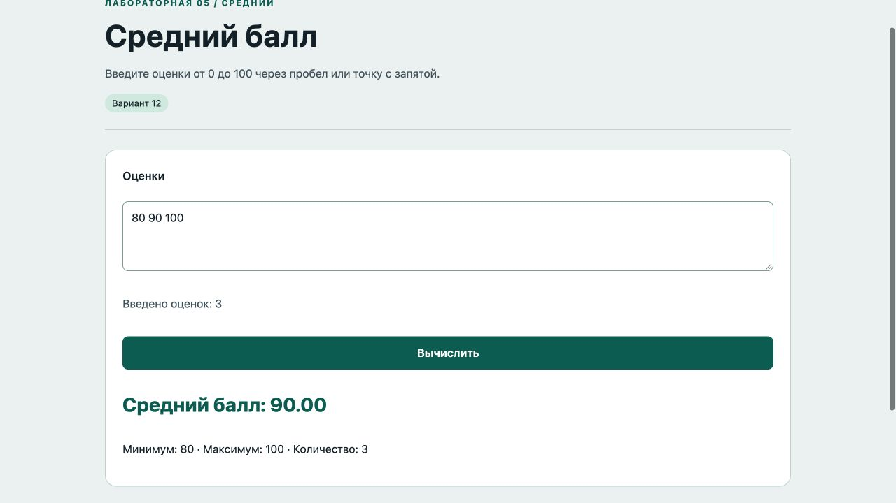

# Отчёт · Лабораторная работа №5

Дисциплина: «Языки и технология программирования».

Тема: Основы JavaScript в браузере.

Уровень: **Средний**. Вариант: **12**.

ФИО: не указано. Группа: не указана. Эти два поля следует заполнить перед сдачей.

## Цель и постановка задачи

Введите оценки от 0 до 100 через пробел или точку с запятой.

Средний балл. Разделить строку на числа, проверить диапазон. Цикл суммирует оценки, среднее = сумма / количество.

## Алгоритм и данные

Разделить строку на числа, проверить диапазон. Цикл суммирует оценки, среднее = сумма / количество.

Ввод осуществляется через подписанные поля и кнопки. Пользовательский текст выводится через `textContent`. Ошибки показываются на странице, перезагрузка для выполнения действия не требуется.

## Запуск и структура

Выполнить в этой папке команду ниже, затем открыть http://localhost:8000. Остановить сервер: Ctrl+C.

```sh
python3 -m http.server 8000
```

[index.html](index.html), [script.js](script.js), [style.css](style.css).

## Проверки

Проверено 21.10.2026. Python: автоматические тесты стандартной библиотеки; веб: действия в браузере через локальный HTTP-сервер.

| № | Действие / вход | Ожидалось | Фактически | Статус |
|---|---|---|---|---|
| 1 | Пустой список | Введите оценки | Введите оценки от 0 до 100 через пробел; десятичная часть через точку или запятую | Пройден |
| 2 | Оценка вне диапазона | Введите оценки | Введите оценки от 0 до 100 через пробел; десятичная часть через точку или запятую | Пройден |
| 3 | 80, 90, 100 | 90.00 | Средний балл: 90.00<br><br>Минимум: 80 · Максимум: 100 · Количество: 3 | Пройден |

## Демонстрация




## Исходный код

### index.html

```html
<!doctype html>
<html lang="ru"><head><meta charset="utf-8"><meta name="viewport" content="width=device-width,initial-scale=1">
<title>Средний балл · Лабораторная 5</title><link rel="stylesheet" href="style.css"><script src="script.js" defer></script></head>
<body><header><div class="eyebrow">Лабораторная 05 / Средний</div><h1>Средний балл</h1><p class="lead">Введите оценки от 0 до 100 через пробел или точку с запятой.</p><span class="badge">Вариант 12</span></header>
<main><section class="panel"><form novalidate><label for="grades">Оценки</label><textarea id="grades" placeholder="80 90 100"></textarea><p id="count" class="muted">Введено оценок: 0</p><button>Вычислить</button></form><div id="result"></div></section><p id="message" class="message" role="status" aria-live="polite"></p></main>
<footer>Языки и технология программирования · Учебный проект · Все данные демонстрационные</footer></body></html>
```

### script.js

```javascript
"use strict";
const $ = (selector) => document.querySelector(selector);
function element(tag, text, className = "") {
  const node = document.createElement(tag);
  node.textContent = text;
  if (className) node.className = className;
  return node;
}
function button(text, action, className = "secondary") {
  const node = element("button", text, className);
  node.type = "button";
  node.addEventListener("click", action);
  return node;
}
function message(text, success = false) {
  $("#message").textContent = text;
  $("#message").className = success ? "message success" : "message error";
}

function tokens() { return $("#grades").value.trim().split(/[\s;]+/).filter(Boolean); }
$("#grades").addEventListener("input", () => { $("#count").textContent = `Введено оценок: ${tokens().length}`; $("#result").replaceChildren(); message(""); });
$("form").addEventListener("submit", (event) => {
  event.preventDefault(); const values = tokens().map((token) => Number(token.replace(",", ".")));
  $("#result").replaceChildren();
  if (!values.length || values.some((n) => !Number.isFinite(n) || n < 0 || n > 100)) { message("Введите оценки от 0 до 100 через пробел; десятичная часть через точку или запятую"); return; }
  let sum = 0; for (const value of values) sum += value;
  $("#result").append(element("p", `Средний балл: ${(sum / values.length).toFixed(2)}`, "stat"), element("p", `Минимум: ${Math.min(...values)} · Максимум: ${Math.max(...values)} · Количество: ${values.length}`));
  message("Расчёт выполнен", true);
});
```

Оформление вынесено в [style.css](style.css).

## Дополнительная возможность

Счётчик оценок при вводе, минимальный и максимальный баллы.

## Ответы для защиты

**Чем let отличается от const?** let допускает переприсваивание, const — нет; объект в const при этом можно изменять.

**Что такое DOM?** Объектное представление документа, через которое JavaScript управляет интерфейсом.

**Зачем нужна функция?** Чтобы выделить повторяемое действие с понятным названием и параметрами.

**Как перебрать данные?** Циклом for, for…of или методом массива.

**Чем textContent отличается от value?** textContent меняет текст узла; value — текущее значение поля формы.

## Вывод

Реализован вариант «Средний балл». Разделить строку на числа, проверить диапазон. Цикл суммирует оценки, среднее = сумма / количество. Проверки, приведённые в таблице (3), пройдены.
