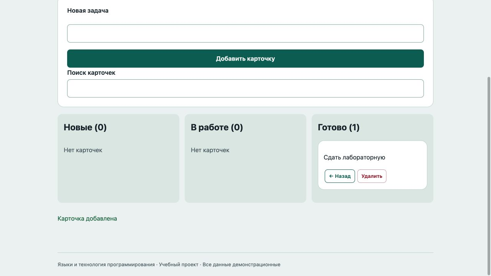

# Отчёт · Лабораторная работа №6

Дисциплина: «Языки и технология программирования».

Тема: DOM и события.

Уровень: **Высокий (повышенный)**. Вариант: **16**.

ФИО: не указано. Группа: не указана. Эти два поля следует заполнить перед сдачей.

## Цель и постановка задачи

Перемещайте задачи от идеи до результата.

Канбан-доска. Карточка хранит id, текст и статус. Кнопки меняют статус, render создаёт колонки и карточки; фильтр не меняет данные.

## Алгоритм и данные

Карточка хранит id, текст и статус. Кнопки меняют статус, render создаёт колонки и карточки; фильтр не меняет данные.

Ввод осуществляется через подписанные поля и кнопки. Пользовательский текст выводится через `textContent`. Ошибки показываются на странице, перезагрузка для выполнения действия не требуется.

Схема взаимодействия: **ввод / submit / click / keydown → обработчик addEventListener → проверка → изменение состояния → создание, удаление или обновление DOM**.

## Запуск и структура

Выполнить в этой папке команду ниже, затем открыть http://localhost:8000. Остановить сервер: Ctrl+C.

```sh
python3 -m http.server 8000
```

[index.html](index.html), [script.js](script.js), [style.css](style.css).

## Проверки

Проверено 21.10.2026. Python: автоматические тесты стандартной библиотеки; веб: действия в браузере через локальный HTTP-сервер.

| № | Действие / вход | Ожидалось | Фактически | Статус |
|---|---|---|---|---|
| 1 | Пустая карточка | Введите название | Введите название задачи | Пройден |
| 2 | Добавление в Новые | Новые (1) | Новые (1)<br><br>Сдать лабораторную<br><br>Далее →Удалить<br>В работе (0)<br><br>Нет карточек<br><br>Готово (0)<br><br>Нет карточек | Пройден |
| 3 | Перенос в работу | В работе (1) | Новые (0)<br><br>Нет карточек<br><br>В работе (1)<br><br>Сдать лабораторную<br><br>← НазадДалее →Удалить<br>Готово (0)<br><br>Нет карточек | Пройден |
| 4 | Перенос в готовые | Готово (1) | Новые (0)<br><br>Нет карточек<br><br>В работе (0)<br><br>Нет карточек<br><br>Готово (1)<br><br>Сдать лабораторную<br><br>← НазадУдалить | Пройден |
| 5 | Удаление карточки | Готово (0) | Новые (0)<br><br>Нет карточек<br><br>В работе (0)<br><br>Нет карточек<br><br>Готово (0)<br><br>Нет карточек | Пройден |

## Демонстрация




## Исходный код

### index.html

```html
<!doctype html>
<html lang="ru"><head><meta charset="utf-8"><meta name="viewport" content="width=device-width,initial-scale=1">
<title>Канбан-доска · Лабораторная 6</title><link rel="stylesheet" href="style.css"><script src="script.js" defer></script></head>
<body><header><div class="eyebrow">Лабораторная 06 / Высокий (повышенный)</div><h1>Канбан-доска</h1><p class="lead">Перемещайте задачи от идеи до результата.</p><span class="badge">Вариант 16</span></header>
<main><section class="panel"><form novalidate><label for="task">Новая задача</label><input id="task" maxlength="160"><button>Добавить карточку</button></form><label for="search">Поиск карточек</label><input id="search" type="search"></section><div id="board" class="board"></div><p id="message" class="message" role="status" aria-live="polite"></p></main>
<footer>Языки и технология программирования · Учебный проект · Все данные демонстрационные</footer></body></html>
```

### script.js

```javascript
"use strict";
const $ = (selector) => document.querySelector(selector);
function element(tag, text, className = "") {
  const node = document.createElement(tag);
  node.textContent = text;
  if (className) node.className = className;
  return node;
}
function button(text, action, className = "secondary") {
  const node = element("button", text, className);
  node.type = "button";
  node.addEventListener("click", action);
  return node;
}
function message(text, success = false) {
  $("#message").textContent = text;
  $("#message").className = success ? "message success" : "message error";
}

let tasks = [], nextId = 1;
const statuses = ["Новые", "В работе", "Готово"];
function render() {
  $("#board").replaceChildren();
  statuses.forEach((status, index) => {
    const column = element("section", "", "column");
    column.append(element("h2", `${status} (${tasks.filter((task) => task.status === index).length})`));
    const visible = tasks.filter((task) => task.status === index && task.text.toLocaleLowerCase().includes($("#search").value.trim().toLocaleLowerCase()));
    for (const task of visible) {
      const card = element("article", "", "card"); card.append(element("p", task.text));
      if (index > 0) card.append(button("← Назад", () => { task.status--; render(); }));
      if (index < 2) card.append(button("Далее →", () => { task.status++; render(); }));
      card.append(button("Удалить", () => { tasks = tasks.filter((item) => item.id !== task.id); render(); }, "danger")); column.append(card);
    }
    if (!visible.length) column.append(element("p", "Нет карточек", "empty"));
    $("#board").append(column);
  });
}
$("form").addEventListener("submit", (event) => {
  event.preventDefault(); const text = $("#task").value.trim();
  if (!text) { message("Введите название задачи"); return; }
  tasks.push({id:nextId++, text, status:0}); $("#task").value = ""; render(); message("Карточка добавлена", true);
});
$("#search").addEventListener("input", render); render();
```

Оформление вынесено в [style.css](style.css).

## Дополнительная возможность

Поиск по карточкам и счётчики по колонкам.

## Ответы для защиты

**Как создать и удалить узел?** document.createElement(), append() и remove().

**Что такое событие?** Сигнал о действии пользователя или браузера; обработчик получает объект event.

**Что такое всплытие?** Событие поднимается от целевого элемента к его предкам.

**Как узнать клавишу?** По event.key в обработчике keydown.

**Почему используется textContent?** Пользовательский текст не разбирается как HTML и не создаёт произвольные элементы.

## Вывод

Реализован вариант «Канбан-доска». Карточка хранит id, текст и статус. Кнопки меняют статус, render создаёт колонки и карточки; фильтр не меняет данные. Проверки, приведённые в таблице (5), пройдены.
