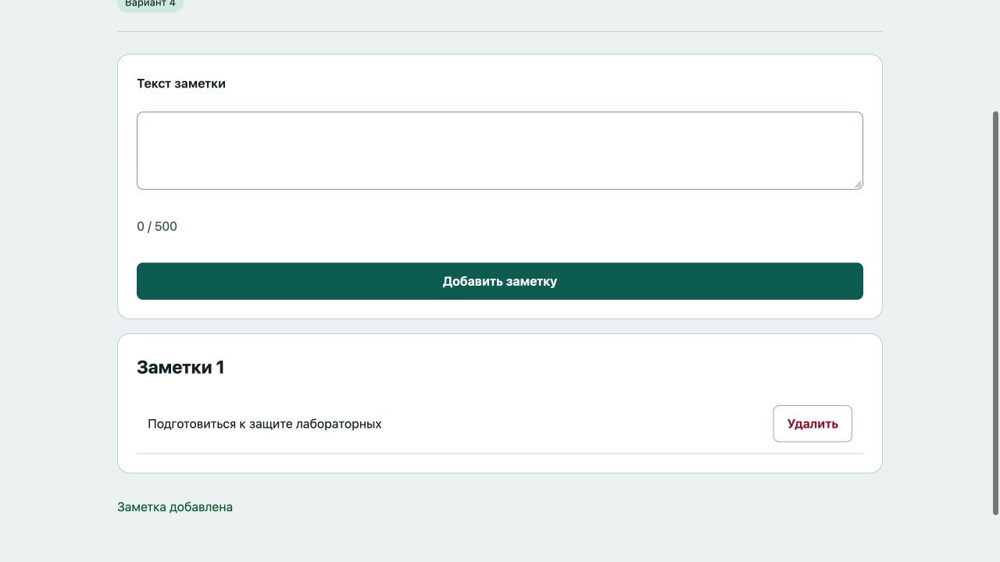

# Отчёт · Лабораторная работа №6

Дисциплина: «Языки и технология программирования».

Тема: DOM и события.

Уровень: **Низкий (базовый)**. Вариант: **4**.

ФИО: не указано. Группа: не указана. Эти два поля следует заполнить перед сдачей.

## Цель и постановка задачи

Добавляйте короткие заметки и удаляйте ненужные.

Блок заметок. Submit создаёт DOM-элемент заметки; кнопка удаления вызывает remove(). Ввод обновляет счётчик символов.

## Алгоритм и данные

Submit создаёт DOM-элемент заметки; кнопка удаления вызывает remove(). Ввод обновляет счётчик символов.

Ввод осуществляется через подписанные поля и кнопки. Пользовательский текст выводится через `textContent`. Ошибки показываются на странице, перезагрузка для выполнения действия не требуется.

Схема взаимодействия: **ввод / submit / click / keydown → обработчик addEventListener → проверка → изменение состояния → создание, удаление или обновление DOM**.

## Запуск и структура

Выполнить в этой папке команду ниже, затем открыть http://localhost:8000. Остановить сервер: Ctrl+C.

```sh
python3 -m http.server 8000
```

[index.html](index.html), [script.js](script.js), [style.css](style.css).

## Проверки

Проверено 21.10.2026. Python: автоматические тесты стандартной библиотеки; веб: действия в браузере через локальный HTTP-сервер.

| № | Действие / вход | Ожидалось | Фактически | Статус |
|---|---|---|---|---|
| 1 | Пустая заметка | Введите текст | Введите текст заметки | Пройден |
| 2 | HTML отображается текстом |  | <br>Удалить | Пройден |
| 3 | HTML не создаёт изображение | 0 | 0 | Пройден |
| 4 | Удаление заметки | 0 | 0 | Пройден |

## Демонстрация




## Исходный код

### index.html

```html
<!doctype html>
<html lang="ru"><head><meta charset="utf-8"><meta name="viewport" content="width=device-width,initial-scale=1">
<title>Блок заметок · Лабораторная 6</title><link rel="stylesheet" href="style.css"><script src="script.js" defer></script></head>
<body><header><div class="eyebrow">Лабораторная 06 / Низкий (базовый)</div><h1>Блок заметок</h1><p class="lead">Добавляйте короткие заметки и удаляйте ненужные.</p><span class="badge">Вариант 4</span></header>
<main><section class="panel"><form novalidate><label for="note">Текст заметки</label><textarea id="note" maxlength="500"></textarea><p id="counter" class="muted">0 / 500</p><button>Добавить заметку</button></form></section><section class="panel"><h2>Заметки <span id="count">0</span></h2><div id="list"></div><p id="empty" class="empty">Пока нет заметок</p></section><p id="message" class="message" role="status" aria-live="polite"></p></main>
<footer>Языки и технология программирования · Учебный проект · Все данные демонстрационные</footer></body></html>
```

### script.js

```javascript
"use strict";
const $ = (selector) => document.querySelector(selector);
function element(tag, text, className = "") {
  const node = document.createElement(tag);
  node.textContent = text;
  if (className) node.className = className;
  return node;
}
function button(text, action, className = "secondary") {
  const node = element("button", text, className);
  node.type = "button";
  node.addEventListener("click", action);
  return node;
}
function message(text, success = false) {
  $("#message").textContent = text;
  $("#message").className = success ? "message success" : "message error";
}

function updateCount() {
  const count = $("#list").children.length;
  $("#count").textContent = String(count); $("#empty").hidden = count !== 0;
}
$("#note").addEventListener("input", () => { $("#counter").textContent = `${$("#note").value.length} / 500`; });
$("form").addEventListener("submit", (event) => {
  event.preventDefault(); const text = $("#note").value.trim();
  if (!text) { message("Введите текст заметки"); return; }
  const row = element("div", "", "item");
  row.append(element("span", text, "text"), button("Удалить", () => { row.remove(); updateCount(); message("Заметка удалена", true); }, "danger"));
  $("#list").append(row); $("#note").value = ""; $("#counter").textContent = "0 / 500"; updateCount(); message("Заметка добавлена", true);
});
```

Оформление вынесено в [style.css](style.css).

## Дополнительная возможность

Счётчики заметок и символов.

## Ответы для защиты

**Как создать и удалить узел?** document.createElement(), append() и remove().

**Что такое событие?** Сигнал о действии пользователя или браузера; обработчик получает объект event.

**Что такое всплытие?** Событие поднимается от целевого элемента к его предкам.

**Как узнать клавишу?** По event.key в обработчике keydown.

**Почему используется textContent?** Пользовательский текст не разбирается как HTML и не создаёт произвольные элементы.

## Вывод

Реализован вариант «Блок заметок». Submit создаёт DOM-элемент заметки; кнопка удаления вызывает remove(). Ввод обновляет счётчик символов. Проверки, приведённые в таблице (4), пройдены.
