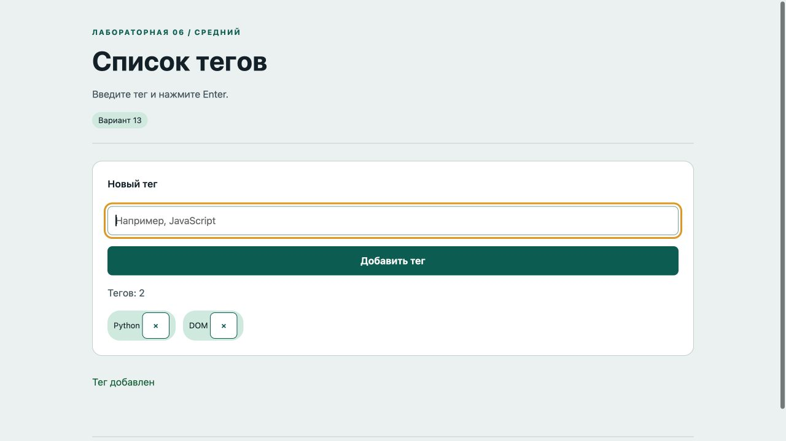

# Отчёт · Лабораторная работа №6

Дисциплина: «Языки и технология программирования».

Тема: DOM и события.

Уровень: **Средний**. Вариант: **13**.

ФИО: не указано. Группа: не указана. Эти два поля следует заполнить перед сдачей.

## Цель и постановка задачи

Введите тег и нажмите Enter.

Список тегов. Событие submit (Enter или кнопка) создаёт тег. Удаление обновляет Set и DOM. Повторы запрещены без учёта регистра.

## Алгоритм и данные

Событие submit (Enter или кнопка) создаёт тег. Удаление обновляет Set и DOM. Повторы запрещены без учёта регистра.

Ввод осуществляется через подписанные поля и кнопки. Пользовательский текст выводится через `textContent`. Ошибки показываются на странице, перезагрузка для выполнения действия не требуется.

Схема взаимодействия: **ввод / submit / click / keydown → обработчик addEventListener → проверка → изменение состояния → создание, удаление или обновление DOM**.

## Запуск и структура

Выполнить в этой папке команду ниже, затем открыть http://localhost:8000. Остановить сервер: Ctrl+C.

```sh
python3 -m http.server 8000
```

[index.html](index.html), [script.js](script.js), [style.css](style.css).

## Проверки

Проверено 21.10.2026. Python: автоматические тесты стандартной библиотеки; веб: действия в браузере через локальный HTTP-сервер.

| № | Действие / вход | Ожидалось | Фактически | Статус |
|---|---|---|---|---|
| 1 | Пустой тег по Enter | не может быть пустым | Тег не может быть пустым | Пройден |
| 2 | Добавление по Enter | Тегов: 1 | Тегов: 1 | Пройден |
| 3 | Повтор без учёта регистра | уже существует | Такой тег уже существует | Пройден |
| 4 | Удаление тега | Тегов: 0 | Тегов: 0 | Пройден |

## Демонстрация




## Исходный код

### index.html

```html
<!doctype html>
<html lang="ru"><head><meta charset="utf-8"><meta name="viewport" content="width=device-width,initial-scale=1">
<title>Список тегов · Лабораторная 6</title><link rel="stylesheet" href="style.css"><script src="script.js" defer></script></head>
<body><header><div class="eyebrow">Лабораторная 06 / Средний</div><h1>Список тегов</h1><p class="lead">Введите тег и нажмите Enter.</p><span class="badge">Вариант 13</span></header>
<main><section class="panel"><form novalidate><label for="tag">Новый тег</label><input id="tag" maxlength="30" placeholder="Например, JavaScript"><button>Добавить тег</button></form><p id="counter" class="muted">Тегов: 0</p><div id="list" class="row"></div></section><p id="message" class="message" role="status" aria-live="polite"></p></main>
<footer>Языки и технология программирования · Учебный проект · Все данные демонстрационные</footer></body></html>
```

### script.js

```javascript
"use strict";
const $ = (selector) => document.querySelector(selector);
function element(tag, text, className = "") {
  const node = document.createElement(tag);
  node.textContent = text;
  if (className) node.className = className;
  return node;
}
function button(text, action, className = "secondary") {
  const node = element("button", text, className);
  node.type = "button";
  node.addEventListener("click", action);
  return node;
}
function message(text, success = false) {
  $("#message").textContent = text;
  $("#message").className = success ? "message success" : "message error";
}

const tags = new Set();
function count() { $("#counter").textContent = `Тегов: ${tags.size}`; }
$("form").addEventListener("submit", (event) => {
  event.preventDefault(); const text = $("#tag").value.trim(), key = text.toLocaleLowerCase();
  if (!text) { message("Тег не может быть пустым"); return; }
  if (tags.has(key)) { message("Такой тег уже существует"); return; }
  tags.add(key);
  const row = element("span", "", "badge");
  const remove = button("×", () => { tags.delete(key); row.remove(); count(); }, "secondary");
  remove.setAttribute("aria-label", `Удалить тег ${text}`);
  row.append(element("span", text + " "), remove); $("#list").append(row);
  $("#tag").value = ""; count(); message("Тег добавлен", true);
});
$("#tag").addEventListener("keydown", (event) => { if (event.key === "Escape") { $("#tag").value = ""; message(""); } });
```

Оформление вынесено в [style.css](style.css).

## Дополнительная возможность

Запрет повторов, счётчик и очистка поля клавишей Escape.

## Ответы для защиты

**Как создать и удалить узел?** document.createElement(), append() и remove().

**Что такое событие?** Сигнал о действии пользователя или браузера; обработчик получает объект event.

**Что такое всплытие?** Событие поднимается от целевого элемента к его предкам.

**Как узнать клавишу?** По event.key в обработчике keydown.

**Почему используется textContent?** Пользовательский текст не разбирается как HTML и не создаёт произвольные элементы.

## Вывод

Реализован вариант «Список тегов». Событие submit (Enter или кнопка) создаёт тег. Удаление обновляет Set и DOM. Повторы запрещены без учёта регистра. Проверки, приведённые в таблице (4), пройдены.
