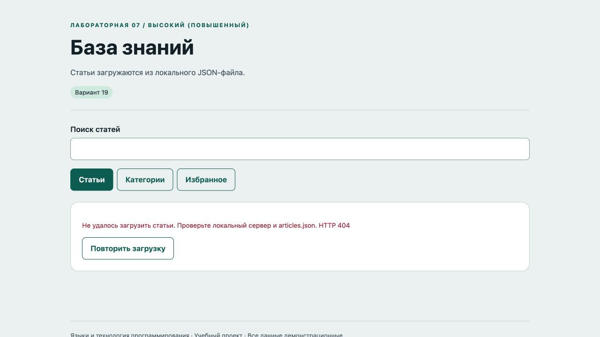
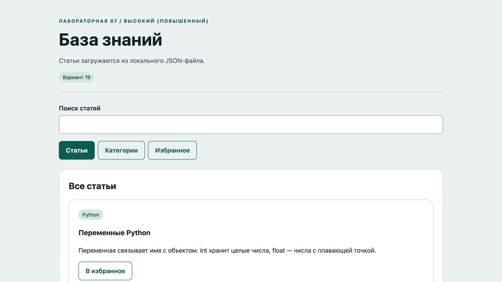
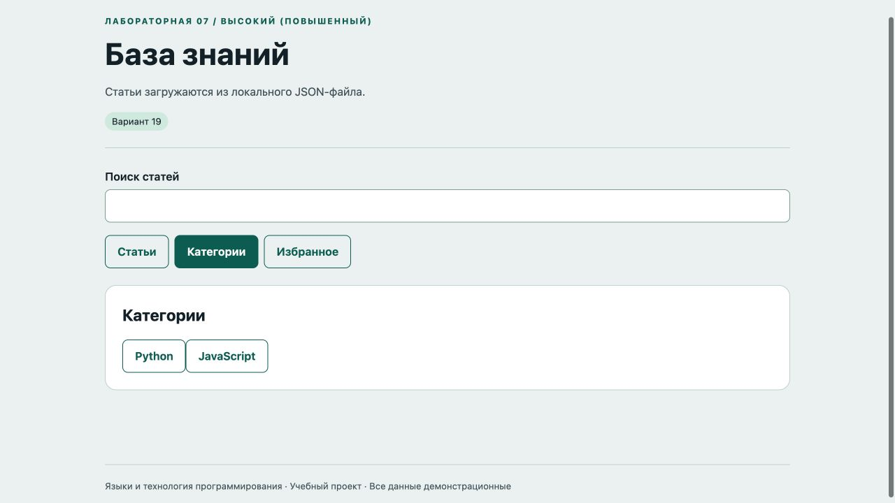
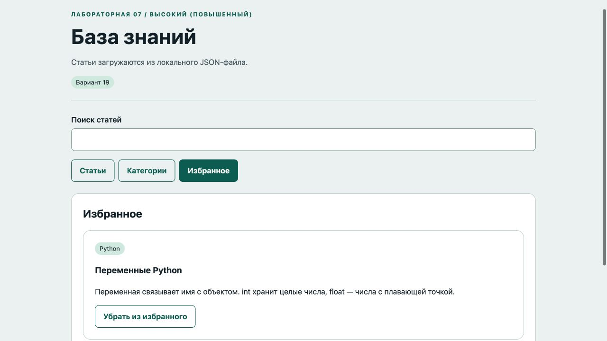

# Отчёт · Лабораторная работа №7

Дисциплина: «Языки и технология программирования».

Тема: SPA без фреймворков.

Уровень: **Высокий (повышенный)**. Вариант: **19**.

ФИО: не указано. Группа: не указана. Эти два поля следует заполнить перед сдачей.

## Цель и постановка задачи

Статьи загружаются из локального JSON-файла.

База знаний. fetch читает articles.json. Проверяется HTTP-статус и структура массива. Состояния загрузки/ошибки/готовности отображаются во вкладках.

## Алгоритм и данные

fetch читает articles.json. Проверяется HTTP-статус и структура массива. Состояния загрузки/ошибки/готовности отображаются во вкладках.

Ввод осуществляется через подписанные поля и кнопки. Пользовательский текст выводится через `textContent`. Ошибки показываются на странице, перезагрузка для выполнения действия не требуется.

Схема вкладок: **Статьи ↔ Категории ↔ Избранное**. Активная вкладка помечена `aria-selected`, стрелки меняют вкладку и фокус.

## Запуск и структура

Выполнить в этой папке команду ниже, затем открыть http://localhost:8000. Остановить сервер: Ctrl+C.

```sh
python3 -m http.server 8000
```

[app.js](app.js), [articles.json](articles.json), [index.html](index.html), [style.css](style.css).

## Проверки

Проверено 21.10.2026. Python: автоматические тесты стандартной библиотеки; веб: действия в браузере через локальный HTTP-сервер.

| № | Действие / вход | Ожидалось | Фактически | Статус |
|---|---|---|---|---|
| 1 | Загрузка локального JSON | 3 | 3 | Пройден |
| 2 | Вкладка категорий | Python | Категории<br>PythonJavaScript | Пройден |
| 3 | Фильтрация по категории | 1 | 1 | Пройден |
| 4 | Избранная статья | Переменные Python | Избранное<br>Python<br>Переменные Python<br><br>Переменная связывает имя с объектом. int хранит целые числа, float — числа с плавающей точкой.<br><br>Убрать из избранного | Пройден |
| 5 | Поиск без совпадений | Статьи не найдены | Избранное<br><br>Статьи не найдены | Пройден |
| 6 | Отсутствующий JSON-файл | Не удалось загрузить статьи | Не удалось загрузить статьи. Проверьте локальный сервер и articles.json. HTTP 404<br><br>Повторить загрузку | Пройден |
| 7 | Повтор загрузки после восстановления JSON | 3 | 3 | Пройден |

## Демонстрация










## Исходный код

### app.js

```javascript
"use strict";
const $ = (selector) => document.querySelector(selector);
function element(tag, text, className = "") {
  const node = document.createElement(tag);
  node.textContent = text;
  if (className) node.className = className;
  return node;
}
function button(text, action, className = "secondary") {
  const node = element("button", text, className);
  node.type = "button";
  node.addEventListener("click", action);
  return node;
}
function message(text, success = false) {
  $("#message").textContent = text;
  $("#message").className = success ? "message success" : "message error";
}

let activeTab = 0;
function activate(index) {
  activeTab = index;
  document.querySelectorAll("[data-tab]").forEach((tab, i) => {
    tab.setAttribute("aria-selected", String(i === index)); tab.tabIndex = i === index ? 0 : -1;
  });
  $("#content").setAttribute("aria-labelledby", `tab-${index}`);
  render();
}
document.querySelectorAll("[data-tab]").forEach((tab, i) => {
  tab.addEventListener("click", () => activate(i));
  tab.addEventListener("keydown", (event) => {
    const count = document.querySelectorAll("[data-tab]").length;
    let index = i;
    if (event.key === "ArrowRight") index = (i + 1) % count;
    else if (event.key === "ArrowLeft") index = (i - 1 + count) % count;
    else if (event.key === "Home") index = 0;
    else if (event.key === "End") index = count - 1;
    else return;
    event.preventDefault(); activate(index); $("#tab-" + index).focus();
  });
});

let articles = [], loading = true, loadError = "", category = "";
const favorites = new Set();
function render() {
  $("#content").replaceChildren();
  if (loading) { $("#content").append(element("p", "Загрузка статей…")); return; }
  if (loadError) { $("#content").append(element("p", loadError, "error"), button("Повторить загрузку", load)); return; }
  if (activeTab === 1) {
    $("#content").append(element("h2", "Категории"));
    for (const name of new Set(articles.map((article) => article.category))) $("#content").append(button(name, () => { category = name; activate(0); }));
    if (!articles.length) $("#content").append(element("p", "Категорий пока нет", "empty"));
    return;
  }
  $("#content").append(element("h2", activeTab === 2 ? "Избранное" : category || "Все статьи"));
  if (category && activeTab === 0) $("#content").append(button("Все категории", () => { category = ""; render(); }));
  const query = $("#search").value.trim().toLocaleLowerCase();
  const visible = articles.filter((a) => (activeTab !== 2 || favorites.has(a.id)) && (activeTab !== 0 || !category || a.category === category) && `${a.title} ${a.text}`.toLocaleLowerCase().includes(query));
  for (const article of visible) {
    const card = element("article", "", "card");
    card.append(element("span", article.category, "badge"), element("h3", article.title), element("p", article.text), button(favorites.has(article.id) ? "Убрать из избранного" : "В избранное", () => {
      if (favorites.has(article.id)) favorites.delete(article.id); else favorites.add(article.id); render();
    })); $("#content").append(card);
  }
  if (!visible.length) $("#content").append(element("p", "Статьи не найдены", "empty"));
}
async function load() {
  loading = true; loadError = ""; render();
  try {
    const response = await fetch("articles.json");
    if (!response.ok) throw new Error("HTTP " + response.status);
    const data = await response.json();
    if (!Array.isArray(data) || !data.every((a) => a && typeof a.id === "number" && [a.title,a.category,a.text].every((s) => typeof s === "string")) || new Set(data.map((a) => a.id)).size !== data.length) throw new Error("Неверный формат данных");
    articles = data;
  } catch (error) { loadError = "Не удалось загрузить статьи. Проверьте локальный сервер и articles.json. " + error.message; }
  finally { loading = false; render(); }
}
$("#search").addEventListener("input", render); activate(0); load();
```

### articles.json

```json
[
  {
    "id": 1,
    "title": "Переменные Python",
    "category": "Python",
    "text": "Переменная связывает имя с объектом. int хранит целые числа, float — числа с плавающей точкой."
  },
  {
    "id": 2,
    "title": "События DOM",
    "category": "JavaScript",
    "text": "addEventListener связывает событие с функцией. preventDefault отменяет стандартное действие, например отправку формы."
  },
  {
    "id": 3,
    "title": "JSON и хранилище",
    "category": "JavaScript",
    "text": "JSON.stringify преобразует объект в строку. JSON.parse восстанавливает значение. Ошибки формата обрабатывают через try/catch."
  }
]
```

### index.html

```html
<!doctype html>
<html lang="ru"><head><meta charset="utf-8"><meta name="viewport" content="width=device-width,initial-scale=1">
<title>База знаний · Лабораторная 7</title><link rel="stylesheet" href="style.css"><script src="app.js" defer></script></head>
<body><header><div class="eyebrow">Лабораторная 07 / Высокий (повышенный)</div><h1>База знаний</h1><p class="lead">Статьи загружаются из локального JSON-файла.</p><span class="badge">Вариант 19</span></header>
<main><div class="toolbar"><label for="search">Поиск статей</label><input id="search" type="search"></div><nav class="tabs" role="tablist" aria-label="Разделы"><button id="tab-0" role="tab" data-tab="0" aria-controls="content" aria-selected="true" tabindex="0">Статьи</button><button id="tab-1" role="tab" data-tab="1" aria-controls="content" aria-selected="false" tabindex="-1">Категории</button><button id="tab-2" role="tab" data-tab="2" aria-controls="content" aria-selected="false" tabindex="-1">Избранное</button></nav><section id="content" class="panel" role="tabpanel" aria-labelledby="tab-0"></section><p id="message" class="message" role="status" aria-live="polite"></p></main>
<footer>Языки и технология программирования · Учебный проект · Все данные демонстрационные</footer></body></html>
```

Оформление вынесено в [style.css](style.css).

## Дополнительная возможность

Поиск, фильтрация по категории, повторная загрузка после ошибки и клавиатурная навигация.

## Ответы для защиты

**Что такое SPA?** Один HTML-документ меняет представления средствами JavaScript без полной перезагрузки.

**Зачем data-атрибуты?** Они связывают кнопку вкладки с индексом представления.

**Что делает fetch()?** Асинхронно запрашивает ресурс и возвращает Response. HTTP-ошибки проверяются через response.ok.

**Зачем HTTP-сервер?** Он позволяет загружать локальный JSON по HTTP с тем же origin.

**Как обеспечена работа клавиатуры?** Tab фокусирует активную вкладку; стрелки, Home и End меняют раздел и фокус.

## Вывод

Реализован вариант «База знаний». fetch читает articles.json. Проверяется HTTP-статус и структура массива. Состояния загрузки/ошибки/готовности отображаются во вкладках. Проверки, приведённые в таблице (7), пройдены.
