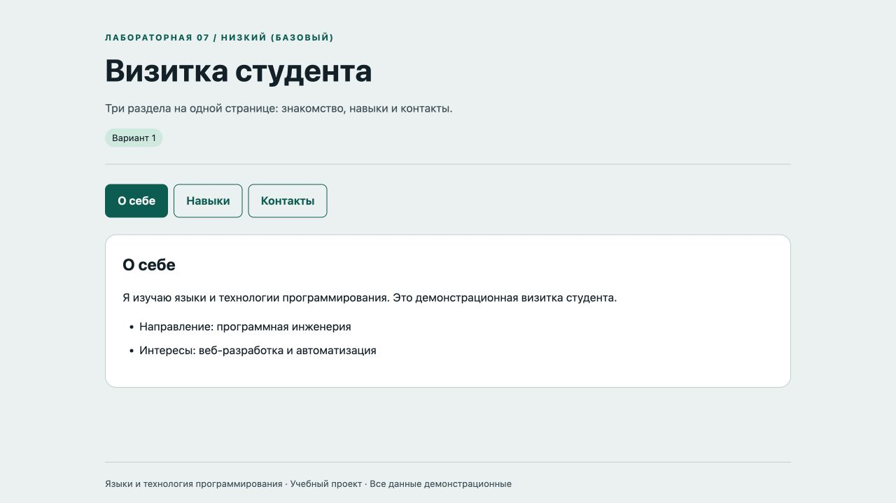
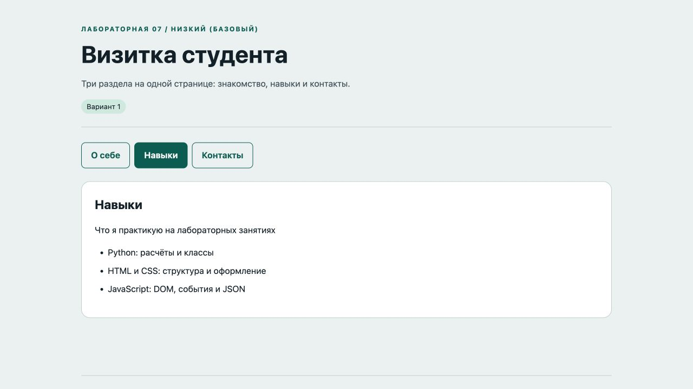
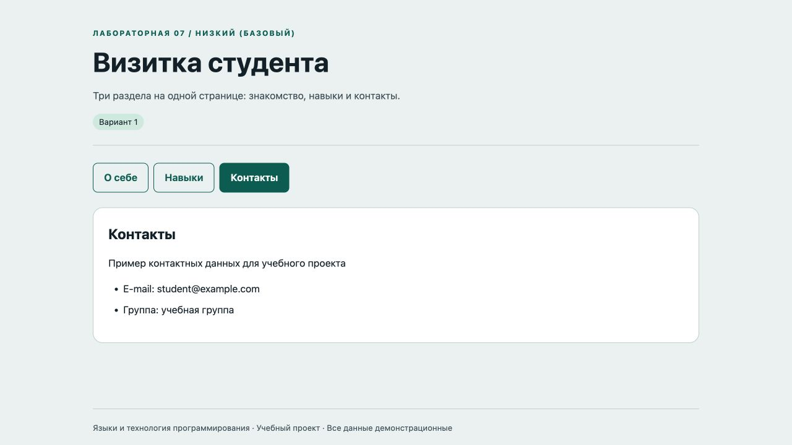

# Отчёт · Лабораторная работа №7

Дисциплина: «Языки и технология программирования».

Тема: SPA без фреймворков.

Уровень: **Низкий (базовый)**. Вариант: **1**.

ФИО: не указано. Группа: не указана. Эти два поля следует заполнить перед сдачей.

## Цель и постановка задачи

Три раздела на одной странице: знакомство, навыки и контакты.

Визитка студента. Объект pages содержит данные разделов. Переключение вкладки изменяет DOM без перезагрузки.

## Алгоритм и данные

Объект pages содержит данные разделов. Переключение вкладки изменяет DOM без перезагрузки.

Ввод осуществляется через подписанные поля и кнопки. Пользовательский текст выводится через `textContent`. Ошибки показываются на странице, перезагрузка для выполнения действия не требуется.

Схема вкладок: **О себе ↔ Навыки ↔ Контакты**. Активная вкладка помечена `aria-selected`, стрелки меняют вкладку и фокус.

## Запуск и структура

Выполнить в этой папке команду ниже, затем открыть http://localhost:8000. Остановить сервер: Ctrl+C.

```sh
python3 -m http.server 8000
```

[app.js](app.js), [index.html](index.html), [style.css](style.css).

## Проверки

Проверено 21.10.2026. Python: автоматические тесты стандартной библиотеки; веб: действия в браузере через локальный HTTP-сервер.

| № | Действие / вход | Ожидалось | Фактически | Статус |
|---|---|---|---|---|
| 1 | Стартовая вкладка | О себе | О себе<br><br>Я изучаю языки и технологии программирования. Это демонстрационная визитка студента.<br><br>Направление: программная инженерия<br>Интересы: веб-разработка и автоматизация | Пройден |
| 2 | Переход на Навыки | Python: расчёты и классы | Навыки<br><br>Что я практикую на лабораторных занятиях<br><br>Python: расчёты и классы<br>HTML и CSS: структура и оформление<br>JavaScript: DOM, события и JSON | Пройден |
| 3 | Переход на Контакты | student@example.com | Контакты<br><br>Пример контактных данных для учебного проекта<br><br>E-mail: student@example.com<br>Группа: учебная группа | Пройден |
| 4 | Home возвращает на первую вкладку | О себе | О себе<br><br>Я изучаю языки и технологии программирования. Это демонстрационная визитка студента.<br><br>Направление: программная инженерия<br>Интересы: веб-разработка и автоматизация | Пройден |
| 5 | Стрелка вправо переключает вкладку | Навыки | Навыки<br><br>Что я практикую на лабораторных занятиях<br><br>Python: расчёты и классы<br>HTML и CSS: структура и оформление<br>JavaScript: DOM, события и JSON | Пройден |

## Демонстрация








## Исходный код

### app.js

```javascript
"use strict";
const $ = (selector) => document.querySelector(selector);
function element(tag, text, className = "") {
  const node = document.createElement(tag);
  node.textContent = text;
  if (className) node.className = className;
  return node;
}
function button(text, action, className = "secondary") {
  const node = element("button", text, className);
  node.type = "button";
  node.addEventListener("click", action);
  return node;
}
function message(text, success = false) {
  $("#message").textContent = text;
  $("#message").className = success ? "message success" : "message error";
}

let activeTab = 0;
function activate(index) {
  activeTab = index;
  document.querySelectorAll("[data-tab]").forEach((tab, i) => {
    tab.setAttribute("aria-selected", String(i === index)); tab.tabIndex = i === index ? 0 : -1;
  });
  $("#content").setAttribute("aria-labelledby", `tab-${index}`);
  render();
}
document.querySelectorAll("[data-tab]").forEach((tab, i) => {
  tab.addEventListener("click", () => activate(i));
  tab.addEventListener("keydown", (event) => {
    const count = document.querySelectorAll("[data-tab]").length;
    let index = i;
    if (event.key === "ArrowRight") index = (i + 1) % count;
    else if (event.key === "ArrowLeft") index = (i - 1 + count) % count;
    else if (event.key === "Home") index = 0;
    else if (event.key === "End") index = count - 1;
    else return;
    event.preventDefault(); activate(index); $("#tab-" + index).focus();
  });
});

const pages = [
  {title:"О себе", text:"Я изучаю языки и технологии программирования. Это демонстрационная визитка студента.", items:["Направление: программная инженерия", "Интересы: веб-разработка и автоматизация"]},
  {title:"Навыки", text:"Что я практикую на лабораторных занятиях", items:["Python: расчёты и классы", "HTML и CSS: структура и оформление", "JavaScript: DOM, события и JSON"]},
  {title:"Контакты", text:"Пример контактных данных для учебного проекта", items:["E-mail: student@example.com", "Группа: учебная группа"]}
];
function render() {
  const page = pages[activeTab], list = document.createElement("ul");
  for (const item of page.items) list.append(element("li", item));
  $("#content").replaceChildren(element("h2", page.title), element("p", page.text), list);
}
activate(0);
```

### index.html

```html
<!doctype html>
<html lang="ru"><head><meta charset="utf-8"><meta name="viewport" content="width=device-width,initial-scale=1">
<title>Визитка студента · Лабораторная 7</title><link rel="stylesheet" href="style.css"><script src="app.js" defer></script></head>
<body><header><div class="eyebrow">Лабораторная 07 / Низкий (базовый)</div><h1>Визитка студента</h1><p class="lead">Три раздела на одной странице: знакомство, навыки и контакты.</p><span class="badge">Вариант 1</span></header>
<main><nav class="tabs" role="tablist" aria-label="Разделы"><button id="tab-0" role="tab" data-tab="0" aria-controls="content" aria-selected="true" tabindex="0">О себе</button><button id="tab-1" role="tab" data-tab="1" aria-controls="content" aria-selected="false" tabindex="-1">Навыки</button><button id="tab-2" role="tab" data-tab="2" aria-controls="content" aria-selected="false" tabindex="-1">Контакты</button></nav><section id="content" class="panel" role="tabpanel" aria-labelledby="tab-0"></section><p id="message" class="message" role="status" aria-live="polite"></p></main>
<footer>Языки и технология программирования · Учебный проект · Все данные демонстрационные</footer></body></html>
```

Оформление вынесено в [style.css](style.css).

## Дополнительная возможность

Навигация стрелками, Home и End; доступные роли вкладок.

## Ответы для защиты

**Что такое SPA?** Один HTML-документ меняет представления средствами JavaScript без полной перезагрузки.

**Зачем data-атрибуты?** Они связывают кнопку вкладки с индексом представления.

**Что делает fetch()?** Асинхронно запрашивает ресурс и возвращает Response. HTTP-ошибки проверяются через response.ok.

**Зачем HTTP-сервер?** Он позволяет загружать локальный JSON по HTTP с тем же origin.

**Как обеспечена работа клавиатуры?** Tab фокусирует активную вкладку; стрелки, Home и End меняют раздел и фокус.

## Вывод

Реализован вариант «Визитка студента». Объект pages содержит данные разделов. Переключение вкладки изменяет DOM без перезагрузки. Проверки, приведённые в таблице (5), пройдены.
