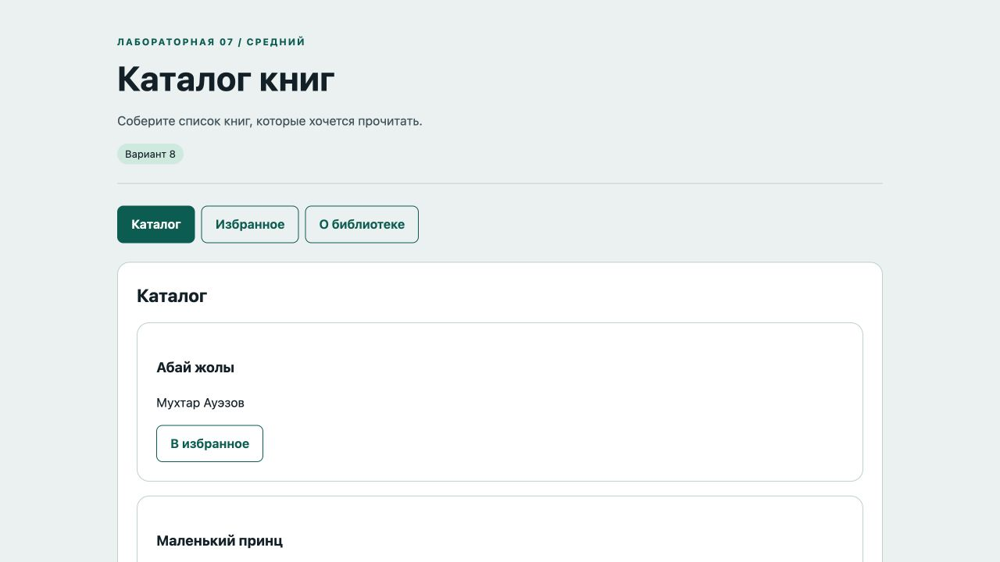
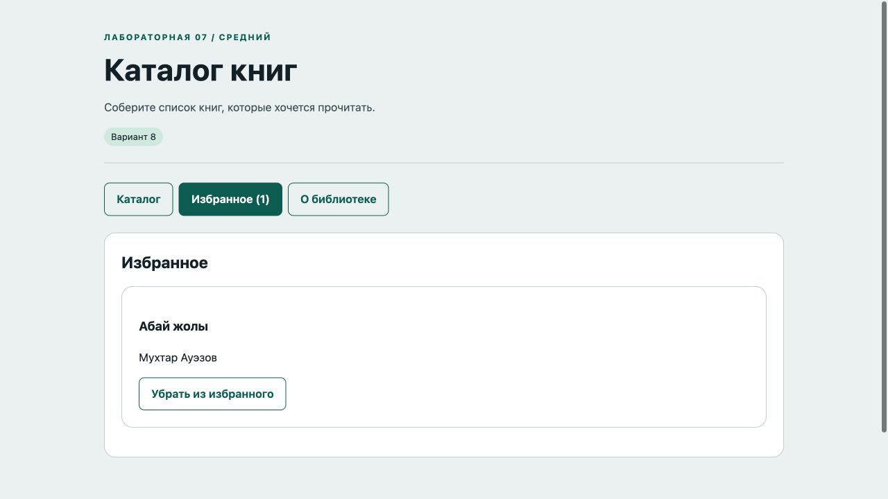
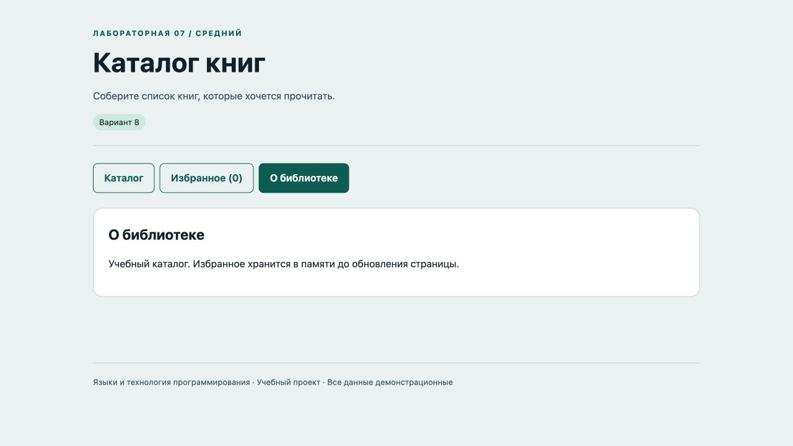

# Отчёт · Лабораторная работа №7

Дисциплина: «Языки и технология программирования».

Тема: SPA без фреймворков.

Уровень: **Средний**. Вариант: **8**.

ФИО: не указано. Группа: не указана. Эти два поля следует заполнить перед сдачей.

## Цель и постановка задачи

Соберите список книг, которые хочется прочитать.

Каталог книг. Массив книг и Set избранного образуют состояние. Вкладки показывают каталог, избранное и сведения; кнопки меняют Set.

## Алгоритм и данные

Массив книг и Set избранного образуют состояние. Вкладки показывают каталог, избранное и сведения; кнопки меняют Set.

Ввод осуществляется через подписанные поля и кнопки. Пользовательский текст выводится через `textContent`. Ошибки показываются на странице, перезагрузка для выполнения действия не требуется.

Схема вкладок: **Каталог ↔ Избранное ↔ О библиотеке**. Активная вкладка помечена `aria-selected`, стрелки меняют вкладку и фокус.

## Запуск и структура

Выполнить в этой папке команду ниже, затем открыть http://localhost:8000. Остановить сервер: Ctrl+C.

```sh
python3 -m http.server 8000
```

[app.js](app.js), [index.html](index.html), [style.css](style.css).

## Проверки

Проверено 21.10.2026. Python: автоматические тесты стандартной библиотеки; веб: действия в браузере через локальный HTTP-сервер.

| № | Действие / вход | Ожидалось | Фактически | Статус |
|---|---|---|---|---|
| 1 | Стартовый каталог | 3 | 3 | Пройден |
| 2 | Пустое избранное | пока нет книг | Избранное<br><br>В избранном пока нет книг | Пройден |
| 3 | Добавление книги | Избранное (1) | Избранное (1) | Пройден |
| 4 | Повторное открытие избранного | Абай жолы | Избранное<br>Абай жолы<br><br>Мухтар Ауэзов<br><br>Убрать из избранного | Пройден |
| 5 | Удаление из избранного | пока нет книг | Избранное<br><br>В избранном пока нет книг | Пройден |
| 6 | Информационная вкладка | Учебный каталог | О библиотеке<br><br>Учебный каталог. Избранное хранится в памяти до обновления страницы. | Пройден |

## Демонстрация








## Исходный код

### app.js

```javascript
"use strict";
const $ = (selector) => document.querySelector(selector);
function element(tag, text, className = "") {
  const node = document.createElement(tag);
  node.textContent = text;
  if (className) node.className = className;
  return node;
}
function button(text, action, className = "secondary") {
  const node = element("button", text, className);
  node.type = "button";
  node.addEventListener("click", action);
  return node;
}
function message(text, success = false) {
  $("#message").textContent = text;
  $("#message").className = success ? "message success" : "message error";
}

let activeTab = 0;
function activate(index) {
  activeTab = index;
  document.querySelectorAll("[data-tab]").forEach((tab, i) => {
    tab.setAttribute("aria-selected", String(i === index)); tab.tabIndex = i === index ? 0 : -1;
  });
  $("#content").setAttribute("aria-labelledby", `tab-${index}`);
  render();
}
document.querySelectorAll("[data-tab]").forEach((tab, i) => {
  tab.addEventListener("click", () => activate(i));
  tab.addEventListener("keydown", (event) => {
    const count = document.querySelectorAll("[data-tab]").length;
    let index = i;
    if (event.key === "ArrowRight") index = (i + 1) % count;
    else if (event.key === "ArrowLeft") index = (i - 1 + count) % count;
    else if (event.key === "Home") index = 0;
    else if (event.key === "End") index = count - 1;
    else return;
    event.preventDefault(); activate(index); $("#tab-" + index).focus();
  });
});

const books = [{id:1,title:"Абай жолы",author:"Мухтар Ауэзов"},{id:2,title:"Маленький принц",author:"Антуан де Сент-Экзюпери"},{id:3,title:"Приключения Тома Сойера",author:"Марк Твен"}];
const favorites = new Set();
function render() {
  $("#content").replaceChildren();
  if (activeTab === 2) { $("#content").append(element("h2", "О библиотеке"), element("p", "Учебный каталог. Избранное хранится в памяти до обновления страницы.")); return; }
  $("#content").append(element("h2", activeTab === 0 ? "Каталог" : "Избранное"));
  const selected = books.filter((book) => activeTab === 0 || favorites.has(book.id));
  if (!selected.length) $("#content").append(element("p", "В избранном пока нет книг", "empty"));
  for (const book of selected) {
    const card = element("article", "", "card");
    card.append(element("h3", book.title), element("p", book.author), button(favorites.has(book.id) ? "Убрать из избранного" : "В избранное", () => {
      if (favorites.has(book.id)) favorites.delete(book.id); else favorites.add(book.id);
      $("#tab-1").textContent = `Избранное (${favorites.size})`; render();
    })); $("#content").append(card);
  }
}
activate(0);
```

### index.html

```html
<!doctype html>
<html lang="ru"><head><meta charset="utf-8"><meta name="viewport" content="width=device-width,initial-scale=1">
<title>Каталог книг · Лабораторная 7</title><link rel="stylesheet" href="style.css"><script src="app.js" defer></script></head>
<body><header><div class="eyebrow">Лабораторная 07 / Средний</div><h1>Каталог книг</h1><p class="lead">Соберите список книг, которые хочется прочитать.</p><span class="badge">Вариант 8</span></header>
<main><nav class="tabs" role="tablist" aria-label="Разделы"><button id="tab-0" role="tab" data-tab="0" aria-controls="content" aria-selected="true" tabindex="0">Каталог</button><button id="tab-1" role="tab" data-tab="1" aria-controls="content" aria-selected="false" tabindex="-1">Избранное</button><button id="tab-2" role="tab" data-tab="2" aria-controls="content" aria-selected="false" tabindex="-1">О библиотеке</button></nav><section id="content" class="panel" role="tabpanel" aria-labelledby="tab-0"></section><p id="message" class="message" role="status" aria-live="polite"></p></main>
<footer>Языки и технология программирования · Учебный проект · Все данные демонстрационные</footer></body></html>
```

Оформление вынесено в [style.css](style.css).

## Дополнительная возможность

Счётчик избранного и клавиатурная навигация.

## Ответы для защиты

**Что такое SPA?** Один HTML-документ меняет представления средствами JavaScript без полной перезагрузки.

**Зачем data-атрибуты?** Они связывают кнопку вкладки с индексом представления.

**Что делает fetch()?** Асинхронно запрашивает ресурс и возвращает Response. HTTP-ошибки проверяются через response.ok.

**Зачем HTTP-сервер?** Он позволяет загружать локальный JSON по HTTP с тем же origin.

**Как обеспечена работа клавиатуры?** Tab фокусирует активную вкладку; стрелки, Home и End меняют раздел и фокус.

## Вывод

Реализован вариант «Каталог книг». Массив книг и Set избранного образуют состояние. Вкладки показывают каталог, избранное и сведения; кнопки меняют Set. Проверки, приведённые в таблице (6), пройдены.
