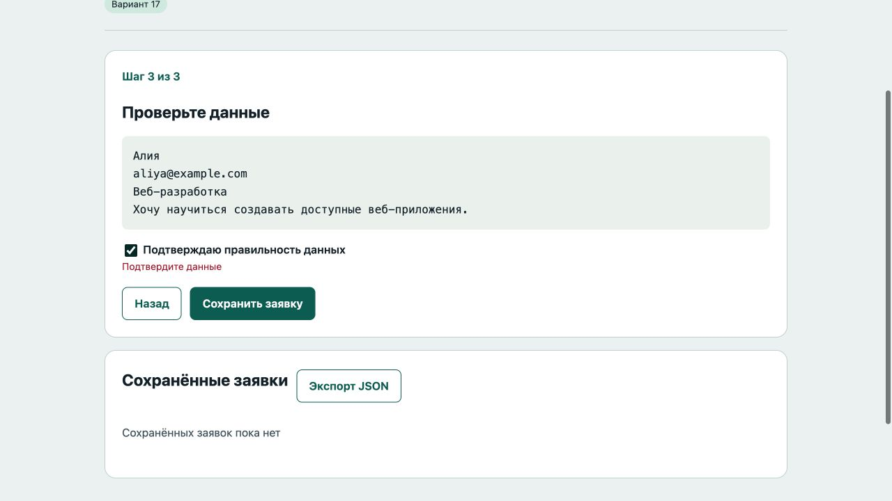
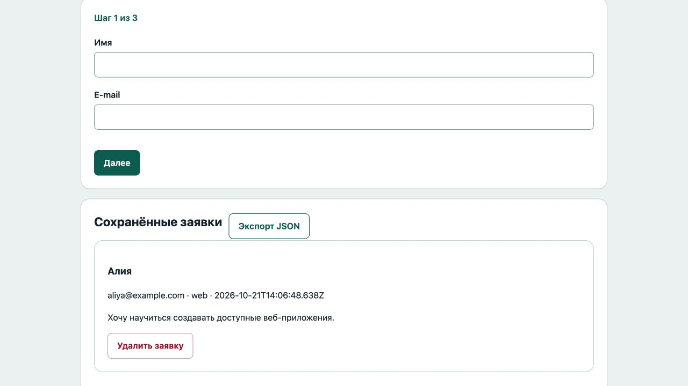

# Отчёт · Лабораторная работа №8

Дисциплина: «Языки и технология программирования».

Тема: JSON и Web Storage.

Уровень: **Высокий (повышенный)**. Вариант: **17**.

ФИО: не указано. Группа: не указана. Эти два поля следует заполнить перед сдачей.

## Цель и постановка задачи

Черновик хранится во вкладке, готовые заявки — между посещениями.

Мастер заявки. Три шага проверяют имя/e-mail, направление/мотивацию и согласие. Черновик записывается в sessionStorage, итог — в localStorage. После сохранения удалить ключ черновика.

## Алгоритм и данные

Три шага проверяют имя/e-mail, направление/мотивацию и согласие. Черновик записывается в sessionStorage, итог — в localStorage. После сохранения удалить ключ черновика.

Ввод осуществляется через подписанные поля и кнопки. Пользовательский текст выводится через `textContent`. Ошибки показываются на странице, перезагрузка для выполнения действия не требуется.

Ключи хранения: sessionStorage: `lab8_high_draft_v1`; localStorage: `lab8_high_applications_v1` (массив итоговых заявок с `created`).

Пример структуры данных:

```json
{
  "step": 1,
  "name": "Алия",
  "email": "aliya@example.com",
  "direction": "web",
  "motivation": "Хочу научиться создавать приложения.",
  "agree": false,
  "id": "demo-1"
}
```

Для ручной проверки откройте DevTools → Application → Local Storage / Session Storage → адрес сервера. Пароли и токены не сохраняются.

## Запуск и структура

Выполнить в этой папке команду ниже, затем открыть http://localhost:8000. Остановить сервер: Ctrl+C.

```sh
python3 -m http.server 8000
```

[app.js](app.js), [index.html](index.html), [style.css](style.css).

## Проверки

Проверено 21.10.2026. Python: автоматические тесты стандартной библиотеки; веб: действия в браузере через локальный HTTP-сервер.

| № | Действие / вход | Ожидалось | Фактически | Статус |
|---|---|---|---|---|
| 1 | Первый запуск | Шаг 1 из 3 | Шаг 1 из 3 | Пройден |
| 2 | Пустой первый шаг | Введите имя | Введите имя | Пройден |
| 3 | Черновик шага восстановлен | Шаг 2 из 3 | Шаг 2 из 3 | Пройден |
| 4 | Короткая мотивация | не менее 20 | Введите не менее 20 символов | Пройден |
| 5 | Отсутствует подтверждение | Подтвердите данные | Подтвердите данные | Пройден |
| 6 | Итоговая заявка восстановлена | Алия | Алия<br><br>aliya@example.com · web · 2026-10-21T14:06:48.638Z<br><br>Хочу научиться создавать доступные веб-приложения.<br><br>Удалить заявку | Пройден |
| 7 | Черновик сброшен после сохранения | Шаг 1 из 3 | Шаг 1 из 3 | Пройден |
| 8 | Удаление заявки сохраняется | Сохранённых заявок пока нет | Сохранённых заявок пока нет | Пройден |
| 9 | Новая независимая вкладка не получает черновик | Шаг 1 из 3 | Шаг 1 из 3 | Пройден |
| 10 | Исходная вкладка сохраняет свой черновик | Шаг 2 из 3 | Шаг 2 из 3 | Пройден |

Дополнительно в `tests/test_storage.cjs` для каждого уровня выполнены семь проверок: отсутствие ключа, корректный JSON, повреждённый JSON, неверная структура, недоступный Storage, превышение квоты, сериализация. Все пройдены.

## Демонстрация






## Исходный код

### app.js

```javascript
"use strict";
const $ = (selector) => document.querySelector(selector);
function element(tag, text, className = "") {
  const node = document.createElement(tag);
  node.textContent = text;
  if (className) node.className = className;
  return node;
}
function button(text, action, className = "secondary") {
  const node = element("button", text, className);
  node.type = "button";
  node.addEventListener("click", action);
  return node;
}
function message(text, success = false) {
  $("#message").textContent = text;
  $("#message").className = success ? "message success" : "message error";
}

// Каждый проект использует собственный ключ, чтобы данные не пересекались.
function readStored(storage, key, fallback, validate) {
  try {
    const raw = storage.getItem(key);
    if (raw === null) return fallback;
    const parsed = JSON.parse(raw);
    if (!validate(parsed)) throw new Error("Неверная структура JSON");
    return parsed;
  } catch { message("Сохранённые данные недоступны или повреждены. Используется пустое состояние."); return fallback; }
}
function writeStored(storage, key, data) {
  try { storage.setItem(key, JSON.stringify(data)); return true; }
  catch { message("Не удалось сохранить: хранилище недоступно или заполнено."); return false; }
}
function exportJSON(data, filename) {
  const url = URL.createObjectURL(new Blob([JSON.stringify(data, null, 2)], {type:"application/json"}));
  const link = document.createElement("a"); link.href = url; link.download = filename; link.click();
  setTimeout(() => URL.revokeObjectURL(url), 1000);
}
// Получение самого объекта Storage тоже может бросить SecurityError.
function storageOrNull(type) { try { return window[type]; } catch { return null; } }

const DRAFT = "lab8_high_draft_v1", SAVED = "lab8_high_applications_v1";
const local = storageOrNull("localStorage"), session = storageOrNull("sessionStorage");
const blank = () => ({step:0,name:"",email:"",direction:"",motivation:"",agree:false,id:crypto.randomUUID()});
function validDraft(data) {
  return data && Number.isInteger(data.step) && data.step >= 0 && data.step <= 2 && typeof data.id === "string" && [data.name,data.email,data.direction,data.motivation].every((value) => typeof value === "string") && ["","web","python"].includes(data.direction) && typeof data.agree === "boolean";
}
function validApplication(data) { return validDraft(data) && data.name.trim() && /^[^\s@]+@[^\s@]+\.[^\s@]+$/.test(data.email) && data.direction && data.motivation.trim().length >= 20 && data.agree && typeof data.created === "string"; }
let draft = readStored(session, DRAFT, blank(), validDraft);
let applications = readStored(local, SAVED, [], (data) => Array.isArray(data) && data.every(validApplication) && new Set(data.map((item) => item.id)).size === data.length);
function fill() { for (const id of ["name","email","direction","motivation"]) $("#"+id).value = draft[id]; $("#agree").checked = draft.agree; }
function collect() { for (const id of ["name","email","direction","motivation"]) draft[id] = $("#"+id).value.trim(); draft.agree = $("#agree").checked; }
function error(id, text) { $("#"+id+"-error").textContent = text; $("#"+id).setAttribute("aria-invalid", String(Boolean(text))); return !text; }
function validate(step) {
  if (step === 0) return [error("name", draft.name ? "" : "Введите имя"), error("email", /^[^\s@]+@[^\s@]+\.[^\s@]+$/.test(draft.email) ? "" : "Введите корректный e-mail")].every(Boolean);
  if (step === 1) return [error("direction", ["web","python"].includes(draft.direction) ? "" : "Выберите направление"), error("motivation", draft.motivation.length >= 20 ? "" : "Введите не менее 20 символов")].every(Boolean);
  return error("agree", draft.agree ? "" : "Подтвердите данные");
}
function renderStep() {
  for (let i = 0; i < 3; i++) $("#step-"+i).hidden = i !== draft.step;
  $("#step").textContent = `Шаг ${draft.step + 1} из 3`;
  $("#back").hidden = draft.step === 0; $("#next").textContent = draft.step === 2 ? "Сохранить заявку" : "Далее";
  $("#review").textContent = `${draft.name}\n${draft.email}\n${draft.direction === "web" ? "Веб-разработка" : "Python"}\n${draft.motivation}`;
}
function renderList() {
  $("#list").replaceChildren();
  for (const application of applications) {
    const row = element("article", "", "card");
    row.append(element("h3", application.name), element("p", `${application.email} · ${application.direction} · ${application.created}`), element("p", application.motivation), button("Удалить заявку", () => {
      const next = applications.filter((item) => item.id !== application.id);
      if (writeStored(local, SAVED, next)) { applications = next; renderList(); message("Заявка удалена", true); }
    }, "danger")); $("#list").append(row);
  }
  if (!applications.length) $("#list").append(element("p", "Сохранённых заявок пока нет", "empty"));
}
$("form").addEventListener("input", () => { collect(); if (writeStored(session, DRAFT, draft)) message("Черновик сохранён в этой вкладке", true); });
$("#back").addEventListener("click", () => { collect(); draft.step--; writeStored(session, DRAFT, draft); renderStep(); });
$("form").addEventListener("submit", (event) => {
  event.preventDefault(); collect();
  if (!validate(draft.step)) { message("Исправьте поля текущего шага"); return; }
  if (draft.step < 2) { draft.step++; writeStored(session, DRAFT, draft); renderStep(); message(""); return; }
  // Повторно проверяем все шаги перед окончательной записью.
  for (let step = 0; step < 3; step++) if (!validate(step)) { draft.step = step; renderStep(); message("Исправьте данные заявки"); return; }
  const next = [...applications.filter((item) => item.id !== draft.id), {...draft, created:new Date().toISOString()}];
  if (!writeStored(local, SAVED, next)) return;
  applications = next;
  try { session.removeItem(DRAFT); } catch { message("Заявка сохранена, но черновик не удалось удалить."); renderList(); return; }
  draft = blank(); fill(); renderStep(); renderList(); message("Заявка сохранена", true);
});
$("#export").addEventListener("click", () => exportJSON(applications, "applications.json"));
fill(); renderStep(); renderList();
```

### index.html

```html
<!doctype html>
<html lang="ru"><head><meta charset="utf-8"><meta name="viewport" content="width=device-width,initial-scale=1">
<title>Мастер заявки · Лабораторная 8</title><link rel="stylesheet" href="style.css"><script src="app.js" defer></script></head>
<body><header><div class="eyebrow">Лабораторная 08 / Высокий (повышенный)</div><h1>Мастер заявки</h1><p class="lead">Черновик хранится во вкладке, готовые заявки — между посещениями.</p><span class="badge">Вариант 17</span></header>
<main><section class="panel"><p id="step" class="step"></p><form novalidate><section id="step-0"><div><label for="name">Имя</label><input id="name" name="name" type="text"  aria-describedby="name-error"><span class="error" id="name-error"></span></div><div><label for="email">E-mail</label><input id="email" name="email" type="email"  aria-describedby="email-error"><span class="error" id="email-error"></span></div></section><section id="step-1" hidden><div><label for="direction">Направление</label><select id="direction" name="direction" aria-describedby="direction-error"><option value="">Выберите…</option><option value="web">Веб-разработка</option><option value="python">Python</option></select><span class="error" id="direction-error"></span></div><label for="motivation">Мотивация (не менее 20 символов)</label><textarea id="motivation" maxlength="2000"></textarea><span id="motivation-error" class="error"></span></section><section id="step-2" hidden><h2>Проверьте данные</h2><pre id="review"></pre><label><input id="agree" type="checkbox">Подтверждаю правильность данных</label><span id="agree-error" class="error"></span></section><div class="row"><button type="button" id="back" class="secondary">Назад</button><button id="next">Далее</button></div></form></section><section class="panel"><div class="row"><h2>Сохранённые заявки</h2><button type="button" id="export" class="secondary">Экспорт JSON</button></div><div id="list"></div></section><p id="message" class="message" role="status" aria-live="polite"></p></main>
<footer>Языки и технология программирования · Учебный проект · Все данные демонстрационные</footer></body></html>
```

Оформление вынесено в [style.css](style.css).

## Дополнительная возможность

Экспорт заявок в JSON; уникальный id предотвращает дубли при повторном сохранении черновика.

## Ответы для защиты

**Чем JSON отличается от объекта?** JSON — текстовый формат; объект JavaScript — значение в памяти.

**Что делают stringify и parse?** JSON.stringify сериализует значение в строку, JSON.parse восстанавливает значение и может бросить ошибку.

**Чем localStorage отличается от sessionStorage?** localStorage сохраняется между посещениями одного origin; sessionStorage относится к сессии вкладки и переживает её обновление.

**Что возвращает getItem при отсутствии ключа?** null.

**Как удалить данные?** removeItem(key) удаляет один ключ; clear() очищает весь Storage текущего origin. Здесь не используется clear(), чтобы не затронуть соседние лабораторные.

**Как проверить Storage вручную?** Открыть DevTools → Application (или Storage) → Local Storage/Session Storage → адрес локального сервера.

**Зачем try/catch?** JSON может быть повреждён, доступ к Storage заблокирован, квота записи исчерпана.

## Вывод

Реализован вариант «Мастер заявки». Три шага проверяют имя/e-mail, направление/мотивацию и согласие. Черновик записывается в sessionStorage, итог — в localStorage. После сохранения удалить ключ черновика. Проверки, приведённые в таблице (10), пройдены.
