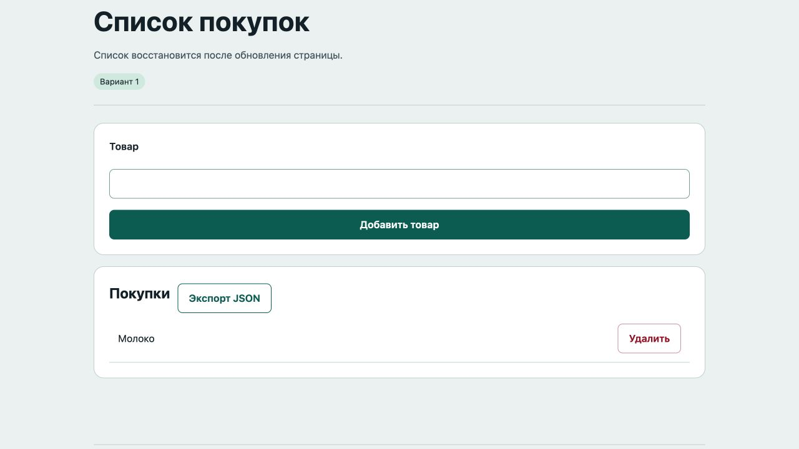

# Отчёт · Лабораторная работа №8

Дисциплина: «Языки и технология программирования».

Тема: JSON и Web Storage.

Уровень: **Низкий (базовый)**. Вариант: **1**.

ФИО: не указано. Группа: не указана. Эти два поля следует заполнить перед сдачей.

## Цель и постановка задачи

Список восстановится после обновления страницы.

Список покупок. Массив строк сериализуется JSON.stringify; при запуске JSON.parse и проверка каждого элемента; удаление сохраняет новый массив.

## Алгоритм и данные

Массив строк сериализуется JSON.stringify; при запуске JSON.parse и проверка каждого элемента; удаление сохраняет новый массив.

Ввод осуществляется через подписанные поля и кнопки. Пользовательский текст выводится через `textContent`. Ошибки показываются на странице, перезагрузка для выполнения действия не требуется.

Ключи хранения: localStorage: `lab8_low_shopping_v1`.

Пример структуры данных:

```json
[
  "Молоко",
  "Хлеб"
]
```

Для ручной проверки откройте DevTools → Application → Local Storage / Session Storage → адрес сервера. Пароли и токены не сохраняются.

## Запуск и структура

Выполнить в этой папке команду ниже, затем открыть http://localhost:8000. Остановить сервер: Ctrl+C.

```sh
python3 -m http.server 8000
```

[app.js](app.js), [index.html](index.html), [style.css](style.css).

## Проверки

Проверено 21.10.2026. Python: автоматические тесты стандартной библиотеки; веб: действия в браузере через локальный HTTP-сервер.

| № | Действие / вход | Ожидалось | Фактически | Статус |
|---|---|---|---|---|
| 1 | Первый запуск | Список покупок пуст | Список покупок пуст | Пройден |
| 2 | Пустой товар | Введите название товара | Введите название товара | Пройден |
| 3 | Добавление товара | Молоко | Молоко<br>Удалить | Пройден |
| 4 | Восстановление после перезагрузки | Молоко | Молоко<br>Удалить | Пройден |
| 5 | Удаление сохраняется после перезагрузки | Список покупок пуст | Список покупок пуст | Пройден |

Дополнительно в `tests/test_storage.cjs` для каждого уровня выполнены семь проверок: отсутствие ключа, корректный JSON, повреждённый JSON, неверная структура, недоступный Storage, превышение квоты, сериализация. Все пройдены.

## Демонстрация




## Исходный код

### app.js

```javascript
"use strict";
const $ = (selector) => document.querySelector(selector);
function element(tag, text, className = "") {
  const node = document.createElement(tag);
  node.textContent = text;
  if (className) node.className = className;
  return node;
}
function button(text, action, className = "secondary") {
  const node = element("button", text, className);
  node.type = "button";
  node.addEventListener("click", action);
  return node;
}
function message(text, success = false) {
  $("#message").textContent = text;
  $("#message").className = success ? "message success" : "message error";
}

// Каждый проект использует собственный ключ, чтобы данные не пересекались.
function readStored(storage, key, fallback, validate) {
  try {
    const raw = storage.getItem(key);
    if (raw === null) return fallback;
    const parsed = JSON.parse(raw);
    if (!validate(parsed)) throw new Error("Неверная структура JSON");
    return parsed;
  } catch { message("Сохранённые данные недоступны или повреждены. Используется пустое состояние."); return fallback; }
}
function writeStored(storage, key, data) {
  try { storage.setItem(key, JSON.stringify(data)); return true; }
  catch { message("Не удалось сохранить: хранилище недоступно или заполнено."); return false; }
}
function exportJSON(data, filename) {
  const url = URL.createObjectURL(new Blob([JSON.stringify(data, null, 2)], {type:"application/json"}));
  const link = document.createElement("a"); link.href = url; link.download = filename; link.click();
  setTimeout(() => URL.revokeObjectURL(url), 1000);
}
// Получение самого объекта Storage тоже может бросить SecurityError.
function storageOrNull(type) { try { return window[type]; } catch { return null; } }

const KEY = "lab8_low_shopping_v1", storage = storageOrNull("localStorage");
let items = readStored(storage, KEY, [], (data) => Array.isArray(data) && data.every((item) => typeof item === "string" && item.trim() && item.length <= 100));
function render() {
  $("#list").replaceChildren();
  items.forEach((item, index) => {
    const row = element("div", "", "item");
    row.append(element("span", item, "text"), button("Удалить", () => {
      const next = items.filter((_, i) => i !== index);
      if (writeStored(storage, KEY, next)) { items = next; render(); message("Товар удалён", true); }
    }, "danger")); $("#list").append(row);
  });
  if (!items.length) $("#list").append(element("p", "Список покупок пуст", "empty"));
}
$("form").addEventListener("submit", (event) => {
  event.preventDefault(); const text = $("#item").value.trim();
  if (!text) { message("Введите название товара"); return; }
  const next = [...items, text];
  if (writeStored(storage, KEY, next)) { items = next; $("#item").value = ""; render(); message("Товар сохранён", true); }
});
$("#export").addEventListener("click", () => exportJSON(items, "shopping.json")); render();
```

### index.html

```html
<!doctype html>
<html lang="ru"><head><meta charset="utf-8"><meta name="viewport" content="width=device-width,initial-scale=1">
<title>Список покупок · Лабораторная 8</title><link rel="stylesheet" href="style.css"><script src="app.js" defer></script></head>
<body><header><div class="eyebrow">Лабораторная 08 / Низкий (базовый)</div><h1>Список покупок</h1><p class="lead">Список восстановится после обновления страницы.</p><span class="badge">Вариант 1</span></header>
<main><section class="panel"><form novalidate><label for="item">Товар</label><input id="item" maxlength="100"><button>Добавить товар</button></form></section><section class="panel"><div class="row"><h2>Покупки</h2><button id="export" type="button" class="secondary">Экспорт JSON</button></div><div id="list"></div></section><p id="message" class="message" role="status" aria-live="polite"></p></main>
<footer>Языки и технология программирования · Учебный проект · Все данные демонстрационные</footer></body></html>
```

Оформление вынесено в [style.css](style.css).

## Дополнительная возможность

Экспорт данных в JSON-файл.

## Ответы для защиты

**Чем JSON отличается от объекта?** JSON — текстовый формат; объект JavaScript — значение в памяти.

**Что делают stringify и parse?** JSON.stringify сериализует значение в строку, JSON.parse восстанавливает значение и может бросить ошибку.

**Чем localStorage отличается от sessionStorage?** localStorage сохраняется между посещениями одного origin; sessionStorage относится к сессии вкладки и переживает её обновление.

**Что возвращает getItem при отсутствии ключа?** null.

**Как удалить данные?** removeItem(key) удаляет один ключ; clear() очищает весь Storage текущего origin. Здесь не используется clear(), чтобы не затронуть соседние лабораторные.

**Как проверить Storage вручную?** Открыть DevTools → Application (или Storage) → Local Storage/Session Storage → адрес локального сервера.

**Зачем try/catch?** JSON может быть повреждён, доступ к Storage заблокирован, квота записи исчерпана.

## Вывод

Реализован вариант «Список покупок». Массив строк сериализуется JSON.stringify; при запуске JSON.parse и проверка каждого элемента; удаление сохраняет новый массив. Проверки, приведённые в таблице (5), пройдены.
