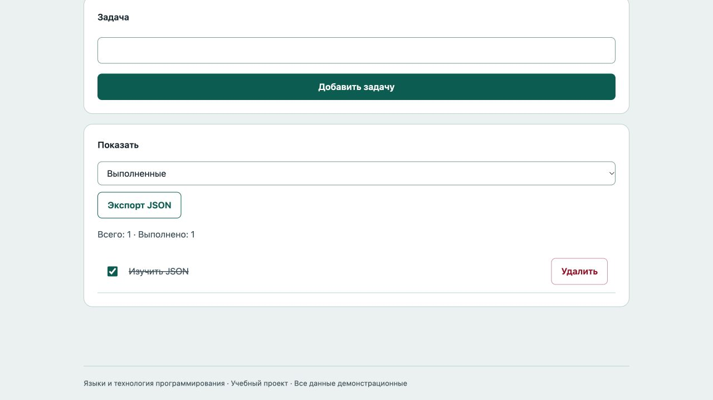

# Отчёт · Лабораторная работа №8

Дисциплина: «Языки и технология программирования».

Тема: JSON и Web Storage.

Уровень: **Средний**. Вариант: **8**.

ФИО: не указано. Группа: не указана. Эти два поля следует заполнить перед сдачей.

## Цель и постановка задачи

Добавляйте задачи, отмечайте выполнение и выбирайте фильтр.

Задачи с сохранением. Сохранять массив объектов {id,text,done}; при загрузке проверять поля и уникальность id. Изменения записывать до обновления интерфейса.

## Алгоритм и данные

Сохранять массив объектов {id,text,done}; при загрузке проверять поля и уникальность id. Изменения записывать до обновления интерфейса.

Ввод осуществляется через подписанные поля и кнопки. Пользовательский текст выводится через `textContent`. Ошибки показываются на странице, перезагрузка для выполнения действия не требуется.

Ключи хранения: localStorage: `lab8_medium_tasks_v1`.

Пример структуры данных:

```json
[
  {
    "id": "demo-1",
    "text": "Изучить JSON",
    "done": false
  }
]
```

Для ручной проверки откройте DevTools → Application → Local Storage / Session Storage → адрес сервера. Пароли и токены не сохраняются.

## Запуск и структура

Выполнить в этой папке команду ниже, затем открыть http://localhost:8000. Остановить сервер: Ctrl+C.

```sh
python3 -m http.server 8000
```

[app.js](app.js), [index.html](index.html), [style.css](style.css).

## Проверки

Проверено 21.10.2026. Python: автоматические тесты стандартной библиотеки; веб: действия в браузере через локальный HTTP-сервер.

| № | Действие / вход | Ожидалось | Фактически | Статус |
|---|---|---|---|---|
| 1 | Первый запуск | Нет задач | Нет задач для этого фильтра | Пройден |
| 2 | Пустая задача | Введите текст задачи | Введите текст задачи | Пройден |
| 3 | Добавление задачи | Изучить JSON | Изучить JSON<br>Удалить | Пройден |
| 4 | Статус восстановлен после перезагрузки | Выполнено: 1 | Всего: 1 · Выполнено: 1 | Пройден |
| 5 | Фильтр активных | Нет задач | Нет задач для этого фильтра | Пройден |
| 6 | Удаление сохраняется | Всего: 0 | Всего: 0 · Выполнено: 0 | Пройден |

Дополнительно в `tests/test_storage.cjs` для каждого уровня выполнены семь проверок: отсутствие ключа, корректный JSON, повреждённый JSON, неверная структура, недоступный Storage, превышение квоты, сериализация. Все пройдены.

## Демонстрация




## Исходный код

### app.js

```javascript
"use strict";
const $ = (selector) => document.querySelector(selector);
function element(tag, text, className = "") {
  const node = document.createElement(tag);
  node.textContent = text;
  if (className) node.className = className;
  return node;
}
function button(text, action, className = "secondary") {
  const node = element("button", text, className);
  node.type = "button";
  node.addEventListener("click", action);
  return node;
}
function message(text, success = false) {
  $("#message").textContent = text;
  $("#message").className = success ? "message success" : "message error";
}

// Каждый проект использует собственный ключ, чтобы данные не пересекались.
function readStored(storage, key, fallback, validate) {
  try {
    const raw = storage.getItem(key);
    if (raw === null) return fallback;
    const parsed = JSON.parse(raw);
    if (!validate(parsed)) throw new Error("Неверная структура JSON");
    return parsed;
  } catch { message("Сохранённые данные недоступны или повреждены. Используется пустое состояние."); return fallback; }
}
function writeStored(storage, key, data) {
  try { storage.setItem(key, JSON.stringify(data)); return true; }
  catch { message("Не удалось сохранить: хранилище недоступно или заполнено."); return false; }
}
function exportJSON(data, filename) {
  const url = URL.createObjectURL(new Blob([JSON.stringify(data, null, 2)], {type:"application/json"}));
  const link = document.createElement("a"); link.href = url; link.download = filename; link.click();
  setTimeout(() => URL.revokeObjectURL(url), 1000);
}
// Получение самого объекта Storage тоже может бросить SecurityError.
function storageOrNull(type) { try { return window[type]; } catch { return null; } }

const KEY = "lab8_medium_tasks_v1", storage = storageOrNull("localStorage");
function validTasks(data) { return Array.isArray(data) && data.every((item) => item && typeof item.id === "string" && typeof item.text === "string" && item.text.trim() && item.text.length <= 160 && typeof item.done === "boolean") && new Set(data.map((item) => item.id)).size === data.length; }
let tasks = readStored(storage, KEY, [], validTasks);
function update(next) { if (writeStored(storage, KEY, next)) { tasks = next; render(); message("Изменения сохранены", true); return true; } return false; }
function render() {
  $("#list").replaceChildren();
  $("#count").textContent = `Всего: ${tasks.length} · Выполнено: ${tasks.filter((task) => task.done).length}`;
  const filter = $("#filter").value;
  const visible = tasks.filter((task) => filter === "all" || task.done === (filter === "done"));
  for (const task of visible) {
    const row = element("div", "", "item" + (task.done ? " done" : ""));
    const toggle = document.createElement("input"); toggle.type = "checkbox"; toggle.checked = task.done; toggle.setAttribute("aria-label", `Выполнено: ${task.text}`);
    toggle.addEventListener("change", () => { if (!update(tasks.map((item) => item.id === task.id ? {...item,done:toggle.checked} : item))) toggle.checked = task.done; });
    row.append(toggle, element("span", task.text, "text"), button("Удалить", () => update(tasks.filter((item) => item.id !== task.id)), "danger")); $("#list").append(row);
  }
  if (!visible.length) $("#list").append(element("p", "Нет задач для этого фильтра", "empty"));
}
$("form").addEventListener("submit", (event) => {
  event.preventDefault(); const text = $("#task").value.trim();
  if (!text) { message("Введите текст задачи"); return; }
  if (update([...tasks, {id:crypto.randomUUID(),text,done:false}])) $("#task").value = "";
});
$("#filter").addEventListener("change", render); $("#export").addEventListener("click", () => exportJSON(tasks, "tasks.json")); render();
```

### index.html

```html
<!doctype html>
<html lang="ru"><head><meta charset="utf-8"><meta name="viewport" content="width=device-width,initial-scale=1">
<title>Задачи с сохранением · Лабораторная 8</title><link rel="stylesheet" href="style.css"><script src="app.js" defer></script></head>
<body><header><div class="eyebrow">Лабораторная 08 / Средний</div><h1>Задачи с сохранением</h1><p class="lead">Добавляйте задачи, отмечайте выполнение и выбирайте фильтр.</p><span class="badge">Вариант 8</span></header>
<main><section class="panel"><form novalidate><label for="task">Задача</label><input id="task" maxlength="160"><button>Добавить задачу</button></form></section><section class="panel"><div class="row"><label for="filter">Показать</label><select id="filter"><option value="all">Все</option><option value="active">Активные</option><option value="done">Выполненные</option></select><button id="export" type="button" class="secondary">Экспорт JSON</button></div><p id="count" class="muted"></p><div id="list"></div></section><p id="message" class="message" role="status" aria-live="polite"></p></main>
<footer>Языки и технология программирования · Учебный проект · Все данные демонстрационные</footer></body></html>
```

Оформление вынесено в [style.css](style.css).

## Дополнительная возможность

Экспорт JSON и статистика выполнения.

## Ответы для защиты

**Чем JSON отличается от объекта?** JSON — текстовый формат; объект JavaScript — значение в памяти.

**Что делают stringify и parse?** JSON.stringify сериализует значение в строку, JSON.parse восстанавливает значение и может бросить ошибку.

**Чем localStorage отличается от sessionStorage?** localStorage сохраняется между посещениями одного origin; sessionStorage относится к сессии вкладки и переживает её обновление.

**Что возвращает getItem при отсутствии ключа?** null.

**Как удалить данные?** removeItem(key) удаляет один ключ; clear() очищает весь Storage текущего origin. Здесь не используется clear(), чтобы не затронуть соседние лабораторные.

**Как проверить Storage вручную?** Открыть DevTools → Application (или Storage) → Local Storage/Session Storage → адрес локального сервера.

**Зачем try/catch?** JSON может быть повреждён, доступ к Storage заблокирован, квота записи исчерпана.

## Вывод

Реализован вариант «Задачи с сохранением». Сохранять массив объектов {id,text,done}; при загрузке проверять поля и уникальность id. Изменения записывать до обновления интерфейса. Проверки, приведённые в таблице (6), пройдены.
